# CogStack NiFi 2.0 workflows: setup guide

## Contents

1. [Overview](#overview)
2. [Before you start](#before-you-start)
3. [Installing the external files](#installing-the-external-files)
4. [Importing a flow and finishing its setup](#importing-a-flow-and-finishing-its-setup)
5. [Flow 1: Ingest binary docs to OpenSearch](#flow-1-ingest-binary-docs-to-opensearch)
6. [Flow 2: Ingest annotations to OpenSearch - Refined](#flow-2-ingest-annotations-to-opensearch---refined)
7. [Flow 3: Extract Anthropometrics](#flow-3-extract-anthropometrics)
8. [Flow 4: Load anthropometrics to OMOP staging DB](#flow-4-load-anthropometrics-to-omop-staging-db)
9. [Flow 5: Load mental health mentions to OMOP staging DB](#flow-5-load-mental-health-mentions-to-omop-staging-db)

## Overview

This guide covers five NiFi 2.7.2 flow definitions. Together they take MIMIC-IV discharge notes from Postgres, index them in OpenSearch, run two NLP pipelines (MedCAT and medspaCy), and load the results into the OMOP staging schema `omop_temp`. Four of the flows use custom Python processors (five in total), and flow 1 uses three Groovy scripts. None of these files are inside the flow definitions, so they must be installed before you import.


_Grey boxes are configurable data stores, blue boxes are flows built on custom Python processors, and the orange box is the flow built on Groovy scripts._

### Atomic and compound NLP entities

The two NLP paths load different kinds of entity into OMOP:

- **Atomic entities (MedCAT: flows 2 → 5).** Each mention is a single concept, such as a SNOMED CT finding, written as one `note_nlp` row. Its meta-annotations become `term_exists` (Y/N) and `term_temporal`. This path writes nothing to the relationship tables.
- **Compound entities (medspaCy: flows 3 → 4).** A measurement has several parts: the concept (body weight), its value (82) and its unit (kg). Each part is its own `note_nlp` row. A `note_nlp_relationship` row of type `COMPOUND_MEASUREMENT` groups them, with one `note_nlp_relationship_part` row per part giving its role (`component`, `has_measured_value` or `scale_type`). This path also writes atomic rows: BMI mentions (with `value_as_number`), "obesity" mentions, and the derived BMI.

So only flow 4 writes to the relationship tables. To read a compound entity back, join through them (see [Flow 4](#flow-4-load-anthropometrics-to-omop-staging-db)).

| # | Flow (process group name) | Reads | Writes | Custom components |
| --- | --- | --- | --- | --- |
| 1 | Ingest binary docs to OpenSearch | `mimiciv_note.discharge_binary`, `mimiciv_note.discharge` | OpenSearch `discharge_summary_document_text`, `discharge_summaries` | 3 Groovy scripts, 1 Avro schema, OCR service |
| 2 | Ingest annotations to OpenSearch - Refined | `mimiciv_note.discharge` | OpenSearch `trext_medcat_annotations` | `CogStackPrepareRecordForNlp`, `CogStackParseCogStackServiceResult` (0.0.1), MedCAT service |
| 3 | Extract Anthropometrics | `mimiciv_note.discharge` | OpenSearch `anthropometrics_bmi_medspacy` | `WeightBmiMedspacy` 1.0.3 |
| 4 | Load anthropometrics to OMOP staging DB | OpenSearch `anthropometrics_bmi_medspacy` | `omop_temp.note_nlp` + relationship tables | `OmopNoteNlpLoader` 1.0.3 |
| 5 | Load mental health mentions to OMOP staging DB | OpenSearch `trext_medcat_annotations` | `omop_temp.note_nlp` | `MedcatNoteNlpLoader` 1.2.0, `cui_filter.txt` |

**Run order.** Flow 4 needs flow 3's index, and flow 5 needs flow 2's annotations. Flow 1 is independent. Set up in this order:

1. Install the external files.
2. Import all five flows.
3. Start flows 1, 2 and 3.
4. Start flows 4 and 5 once their source indexes have data.

## Before you start

The flows were exported from NiFi **2.7.2** running in the CogStack NiFi container (`cogstack-nifi`). Import them into the same NiFi version. A different 2.x version usually works, but the standard processors may show version warnings until you change them.

- [ ] **These hostnames resolve from the NiFi container:**
  - `samples-db:5432` (Postgres, database `mimic`)
  - `elasticsearch-1:9200` and `elasticsearch-2:9200` (OpenSearch, HTTPS)
  - `ocr-service:8090` (Tika OCR, flow 1)
  - `cogstack-medcat-service-production:5000` (MedCAT, flow 2)
- [ ] **The OpenSearch certificates are at the same path inside the container:** `/security/certificates/elastic/opensearch/elasticsearch/elasticsearch-1/`. That folder holds `elasticsearch-1-keystore.jks` and `elasticsearch-1-truststore.key` (a JKS file despite its name). You'll also need the keystore, key and truststore passwords.
- [ ] **Credentials are to hand:** Postgres user `test`, OpenSearch user `admin`, and their passwords. Flow definitions never contain passwords.
- [ ] **The OMOP staging DB has been initialised.** Its initialisation scripts create `note_nlp`, `note_nlp_relationship` and `note_nlp_relationship_part` in `omop_temp`, with `note_nlp_concept_id` and `note_nlp_source_concept_id` as `bigint`. They also create the index the loaders use for their duplicate check:

  ```sql
  CREATE INDEX IF NOT EXISTS note_nlp_note_system_idx ON omop_temp.note_nlp (note_id, nlp_system);
  ```

  If your database was initialised before the index was added to the scripts, run the statement once by hand. It's safe to re-run (`IF NOT EXISTS`).

- [ ] **Python 3.11 is in the container**, which the CogStack image provides. The NumPy pin in `WeightBmiMedspacy` assumes 3.11.

## Installing the external files

A flow definition records only the *paths* and *processor versions* it uses, not the files themselves. Put every file below at exactly this path inside the NiFi container before importing. Otherwise the processors import as invalid, or as missing in the case of Python processors.

| File | Used by | Path in the container |
| --- | --- | --- |
| `weight_and_bmi_medspacy_extraction.py` (processor `WeightBmiMedspacy` **1.0.3**) | Flow 3 | `/opt/nifi/nifi-current/python_extensions/` |
| `omop_note_nlp_loader.py` (processor `OmopNoteNlpLoader` **1.0.3**) | Flow 4 | `/opt/nifi/nifi-current/python_extensions/` |
| `medcat_omop_note_nlp_loader.py` (processor `MedcatNoteNlpLoader` **1.2.0**) | Flow 5 | `/opt/nifi/nifi-current/python_extensions/` |
| `CogStackPrepareRecordForNlp`, `CogStackParseCogStackServiceResult` (**0.0.1**) | Flow 2 | Ship with the CogStack NiFi image. If missing, copy them from the CogStack-NiFi repository into the same folder. |
| `prepare-db-record-for-tika-request-single-mimic.groovy` | Flow 1 | `/opt/nifi/user_scripts/` |
| `parse-tika-response-single-mimic.groovy` | Flow 1 | `/opt/nifi/user_scripts/` |
| `parse-tika-result-json-to-avro-mimic.groovy` | Flow 1 | `/opt/nifi/user_scripts/` |
| `document-mimic.avsc` (Avro schema) | Flow 1 | `/opt/nifi/user_schemas/` |
| `cui_filter.txt` | Flow 5 | `/opt/nifi/user_scripts/` |
| `postgresql-42.7.7.jar` (JDBC driver) | Flows 1, 2, 3 | `/opt/nifi/drivers/` |

**File names and processor names differ.** NiFi identifies a Python processor by the class name inside the file (`WeightBmiMedspacy`, `OmopNoteNlpLoader`, `MedcatNoteNlpLoader`), not by the file name. That class name is what you search for in the Add Processor dialog and what the flow definitions refer to. It's also the name of each processor's dependency folder under `/opt/nifi/user_scripts/extensions/`. Keep exactly one file per processor in the extensions folder. If a renamed copy and an old copy both define the same class, NiFi lists the processor twice.

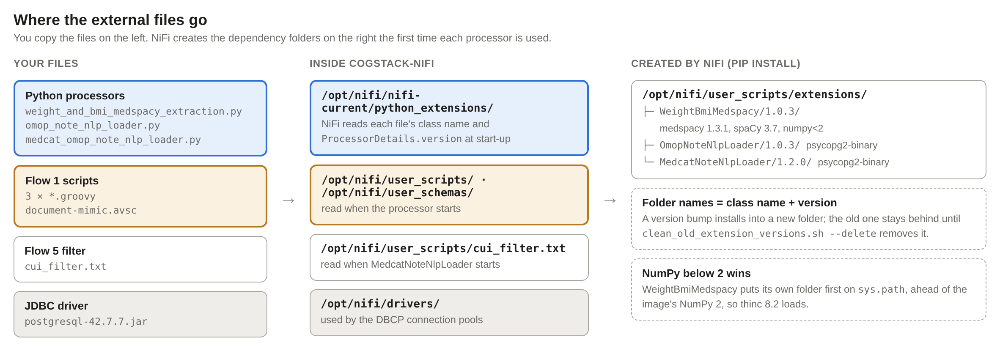

### Step 1: Check what's already there

```bash
docker exec cogstack-nifi bash -c 'ls -l /opt/nifi/nifi-current/python_extensions /opt/nifi/user_scripts /opt/nifi/user_schemas /opt/nifi/drivers'
```

### Step 2: Find out which folders are mounted from the host

```bash
docker inspect cogstack-nifi --format '{{range .Mounts}}{{.Source}} -> {{.Destination}}{{"\n"}}{{end}}'
```

CogStack normally mounts `user_scripts`, `user_schemas` and `security` from the host. If a folder is mounted, copy files into its **host** folder instead, so they survive the container being recreated. A file copied with `docker cp` into a folder that isn't mounted is lost when the container is rebuilt.

### Step 3: Copy the files in

```bash
# Python processors
docker cp weight_and_bmi_medspacy_extraction.py cogstack-nifi:/opt/nifi/nifi-current/python_extensions/
docker cp omop_note_nlp_loader.py                cogstack-nifi:/opt/nifi/nifi-current/python_extensions/
docker cp medcat_omop_note_nlp_loader.py         cogstack-nifi:/opt/nifi/nifi-current/python_extensions/

# Groovy scripts, CUI filter, Avro schema, JDBC driver
docker cp prepare-db-record-for-tika-request-single-mimic.groovy cogstack-nifi:/opt/nifi/user_scripts/
docker cp parse-tika-response-single-mimic.groovy                 cogstack-nifi:/opt/nifi/user_scripts/
docker cp parse-tika-result-json-to-avro-mimic.groovy             cogstack-nifi:/opt/nifi/user_scripts/
docker cp cui_filter.txt                                          cogstack-nifi:/opt/nifi/user_scripts/
docker exec -u 0 cogstack-nifi mkdir -p /opt/nifi/user_schemas /opt/nifi/drivers
docker cp document-mimic.avsc     cogstack-nifi:/opt/nifi/user_schemas/
docker cp postgresql-42.7.7.jar   cogstack-nifi:/opt/nifi/drivers/

# Make everything readable by the NiFi user
docker exec -u 0 cogstack-nifi chmod -R a+rX /opt/nifi/nifi-current/python_extensions /opt/nifi/user_scripts /opt/nifi/user_schemas /opt/nifi/drivers
```

### Step 4: Restart NiFi and let the Python dependencies install

```bash
docker restart cogstack-nifi
```

NiFi discovers the new Python processors when it starts. The first time each processor is used, NiFi pip-installs its dependencies into `/opt/nifi/user_scripts/extensions/<Processor>/<version>/`:

- `WeightBmiMedspacy` installs medspaCy, spaCy and a NumPy version below 2. This takes several minutes.
- The two loaders install only `psycopg2-binary`.

Watch progress with:

```bash
docker exec cogstack-nifi tail -f /opt/nifi/nifi-current/logs/nifi-app.log
```


_Add Processor dialog filtered to "Medcat", showing MedcatNoteNlpLoader 1.2.0. Illustration, not a screenshot._

### Versions must match

Each flow records the exact version of each processor it uses. If the `.py` file you installed (for example `medcat_omop_note_nlp_loader.py`) declares a different `version` in its `ProcessorDetails`, the processor imports as missing. Right-click it → **Change Version** and pick the installed version.

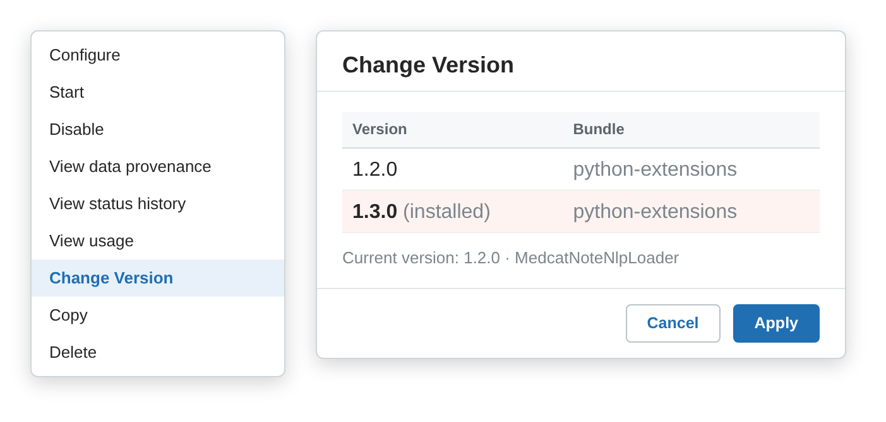

_Right-click → Change Version, and picking the installed version. Illustration, not a screenshot._

The Groovy scripts, CUI filter and Avro schema don't need a NiFi restart. Each is read when its processor starts, so after editing one, stop and start that processor.

### Cleaning up old dependency folders

Every version bump leaves the previous dependency folder behind. To remove them, run `clean_old_extension_versions.sh` with all three processors in its `PROCESSORS` list. Use the class names, not the file names. The script finds each processor's file by its class name, so your file names don't matter:

```bash
PROCESSORS="WeightBmiMedspacy OmopNoteNlpLoader MedcatNoteNlpLoader"
```

## Importing a flow and finishing its setup

Repeat these steps for each JSON file.

1. **Import.** Drag the **Process Group** icon from the top toolbar onto the canvas. Click the upload icon next to the Name field, choose the `.json` file, then click **Add**.

   

   _Create Process Group dialog, with the upload icon for a flow definition. Illustration, not a screenshot._

2. **Re-enter the passwords.** Flow definitions never carry sensitive values. Open the group, right-click empty canvas → **Controller Services**, and fill in:

   | Service or processor | Blank sensitive properties | In flows |
   | --- | --- | --- |
   | StandardSSLContextService | Keystore Password, Key Password, Truststore Password | 1 (two copies), 2 (two copies), 3, 4, 5 |
   | ElasticSearchClientServiceImpl | Password (user `admin`) | 1, 2, 3, 4, 5 |
   | DBCPConnectionPool | Password (user `test`) | 1 (top group and the "Ingest free-text documents from DB" subgroup), 2, 3 |
   | `OmopNoteNlpLoader` / `MedcatNoteNlpLoader` processor | Database Password | 4 / 5 |

   

   _Controller Services in flow 3 straight after import, before passwords are entered. Illustration, not a screenshot._

3. **Enable the services.** Enable each SSL Context Service first, because the Elasticsearch client depends on it. Then enable the Elasticsearch client, the DBCP pool and the record readers and writers. Every processor should now show a red stop square, not a yellow warning.
4. **Check the Python processors.** A processor that shows as missing or ghosted means its `.py` file isn't installed, or is installed at a different version (see [Versions must match](#versions-must-match)).
5. **Don't start anything yet.** Each flow's section below lists what to check first. Imported processors start with no state, so GenerateTableFetch and ConsumeElasticsearch read their sources from the beginning.

**With or without external services.** If a flow was exported *with* external services, it brings its own copy of "ElasticSearchClientServiceImpl - CogStack ES cluster" and its SSL Context Service. Importing several flows like that leaves several copies, and a password change then means updating each one. To keep a single copy:

1. Create the client and SSL service once, at the top level of the canvas (right-click empty canvas at the root → Controller Services).
2. Point each processor's **Client Service** at it.
3. Delete the copies inside the groups.

If a flow was exported *without* external services, NiFi links it to a compatible service in a parent group automatically, as long as there is exactly one. Otherwise the processor shows as invalid until you select one.

To reuse the flows across environments, move hostnames, schemas and passwords into a **Parameter Context**. Use sensitive parameters for the passwords, and reference each parameter as `#{name}`.

### How the flows read incrementally

Each flow's first processor keeps a checkpoint in NiFi state, so it reads only what is new on each run. An imported flow has no state, so it starts from the beginning. To re-read everything later, stop the processor, right-click → **View State → Clear State**, and start it again.

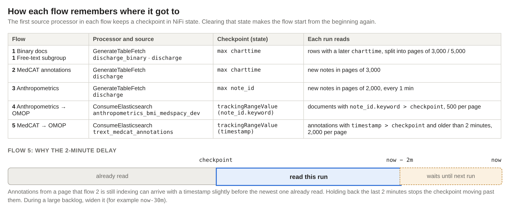

**About the failure funnels.** Every flow sends failures to funnels with no outgoing connection, so failed FlowFiles wait there for you to inspect. Those queues have back pressure too (10,000 FlowFiles by default), and if one fills up, the processor feeding it stops. Check them now and then: inspect or replay what's there, then right-click the connection → **Empty Queue**.

## Flow 1: Ingest binary docs to OpenSearch

This flow sends each binary discharge document through the Tika OCR service and indexes the extracted text. A subgroup also copies the free-text notes into OpenSearch unchanged.

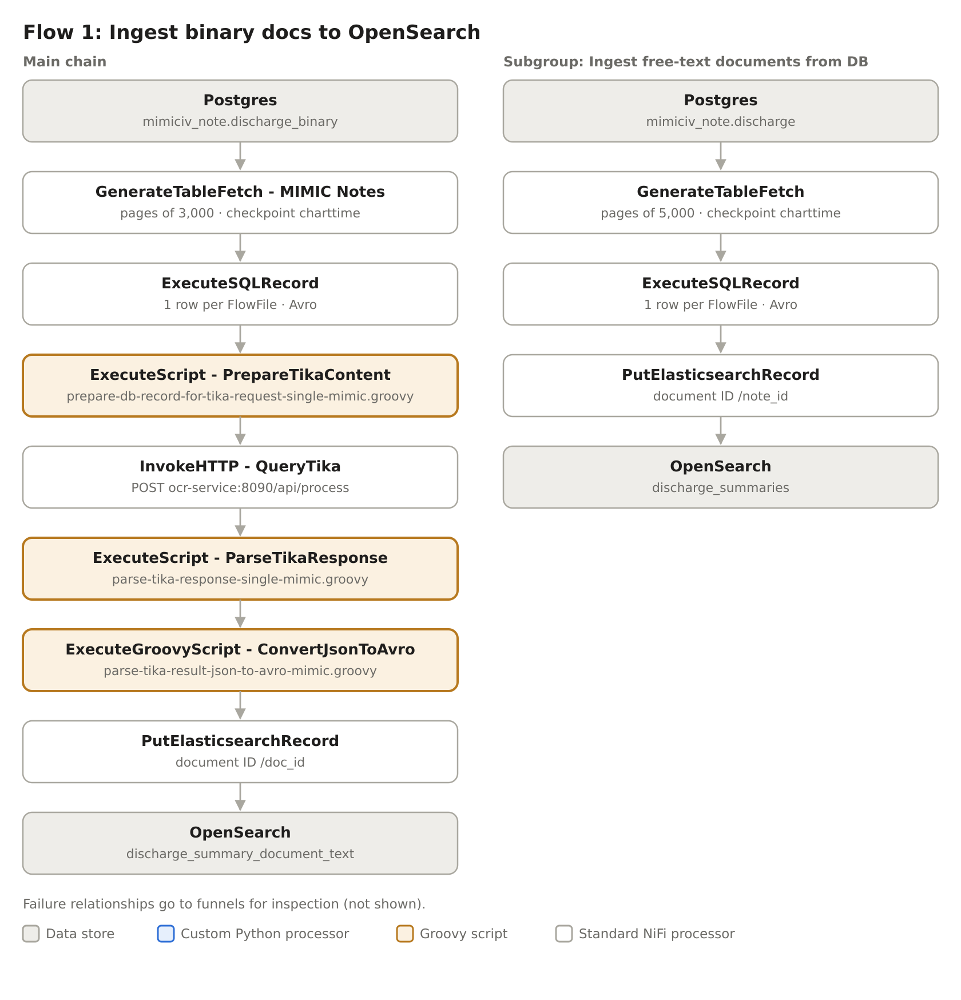

On the canvas after import, before any services are enabled:


_Drawn from the processor positions and connections in the flow definition. Illustration, not a screenshot._

Inside the "Ingest free-text documents from DB" subgroup:

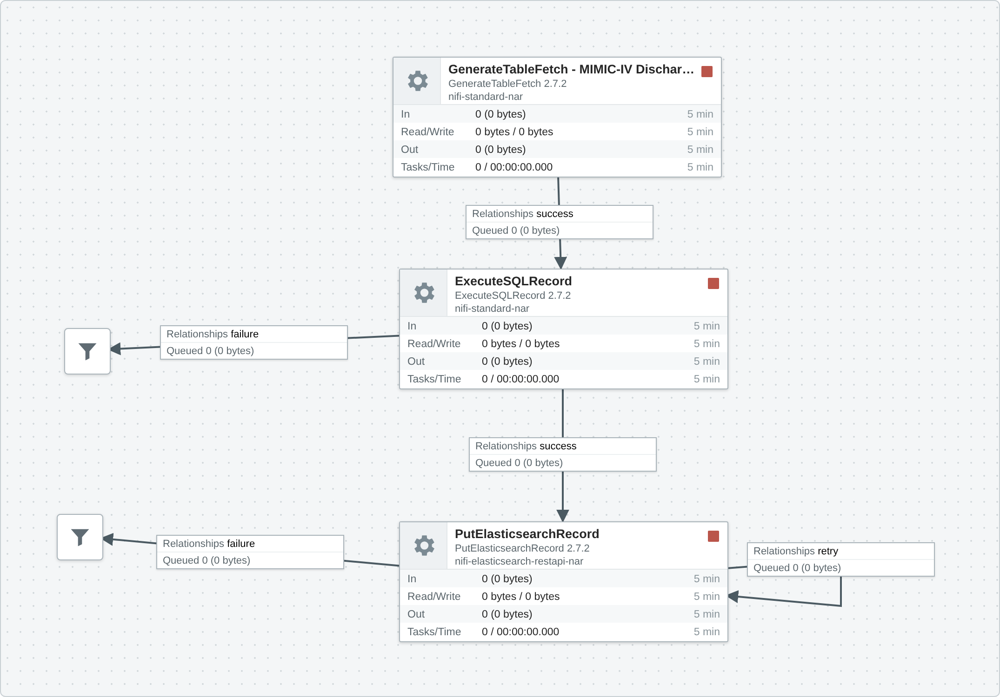

**Main chain** (top level of the group):

1. **GenerateTableFetch - MIMIC Notes** reads `mimiciv_note.discharge_binary` (`hadm_id, note_id, subject_id, charttime, storetime, file_data`) in pages of 3,000. Its checkpoint is the maximum `charttime`, and pages are partitioned on `hadm_id`.
2. **ExecuteSQLRecord** (5 tasks) writes one row per FlowFile, as Avro.
3. **ExecuteScript - PrepareTikaContent** runs `prepare-db-record-for-tika-request-single-mimic.groovy`. Its dynamic properties map the columns: `binary_field = file_data`, `document_id_field = hadm_id` and `document_date = charttime`, plus `note_id` and `subject_id`.
4. **InvokeHTTP - QueryTika** sends `POST http://ocr-service:8090/api/process`, with a 600-second read timeout. `Retry` loops back to itself; `No Retry` and `Failure` go to a funnel.
5. **ExecuteScript - ParseTikaResponse** runs `parse-tika-response-single-mimic.groovy`.
6. **ExecuteGroovyScript - ConvertJsonToAvro** runs `parse-tika-result-json-to-avro-mimic.groovy`, using the schema at `/opt/nifi/user_schemas/document-mimic.avsc`.
7. **PutElasticsearchRecord** writes to index `discharge_summary_document_text`, with the document ID taken from `/doc_id`.

**Subgroup "Ingest free-text documents from DB":** GenerateTableFetch on `mimiciv_note.discharge` (pages of 5,000, checkpoint `charttime`) → ExecuteSQLRecord → PutElasticsearchRecord into `discharge_summaries`, ID `/note_id`. It uses the parent group's Avro reader and writer, so keep it inside this group.

**Before starting:**

- [ ] **Delete the empty subgroup**, also named "Ingest binary docs to OpenSearch". It contains nothing.
- [ ] **Set Run Schedule on both GenerateTableFetch processors**, for example to `1 min`. At `0 sec` they query Postgres continuously, even when nothing has changed.
- [ ] **Check the OCR service responds.** This should print a status code, not a connection error:

  ```bash
  docker exec cogstack-nifi curl -s -o /dev/null -w '%{http_code}\n' http://ocr-service:8090/
  ```

- [ ] **Route failures instead of dropping them.** GenerateTableFetch `failure`, the top-level ExecuteSQLRecord `failure`, and PutElasticsearchRecord `errors` (after retries) are auto-terminated, which silently discards them. Send them to a funnel instead.
- [ ] **Ignore the canvas label about "Restart On Finish?".** No processor in this flow has that property; the label is left over from an older version.

**Run:** start the subgroup and the main chain. Check progress with:

```bash
curl -k -u admin:<password> https://elasticsearch-1:9200/discharge_summary_document_text/_count
curl -k -u admin:<password> https://elasticsearch-1:9200/discharge_summaries/_count
```

## Flow 2: Ingest annotations to OpenSearch - Refined

This flow sends discharge notes to the MedCAT service in bulk and indexes one OpenSearch document per annotation, keyed by `annotation_id`.

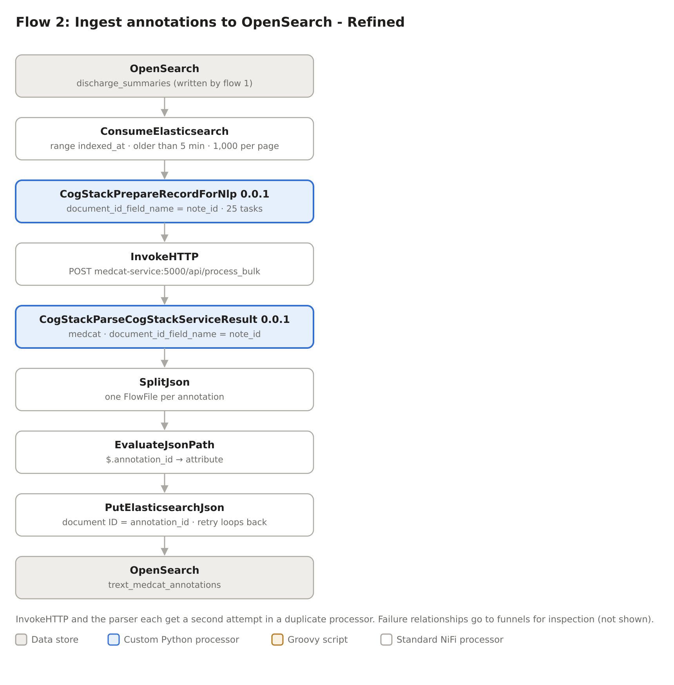

On the canvas after import, before any services are enabled:

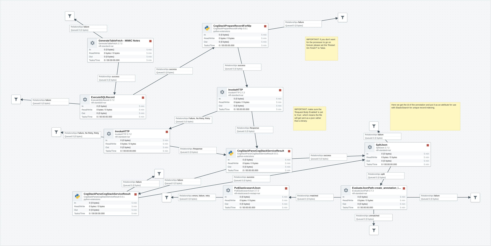

_Drawn from the processor positions and connections in the flow definition. Illustration, not a screenshot._

1. **GenerateTableFetch - MIMIC Notes** reads `mimiciv_note.discharge` as `note_id AS id, text`, in pages of 3,000 partitioned on `hadm_id`. Its checkpoint is the maximum `charttime`.
2. **ExecuteSQLRecord** (5 tasks) writes one FlowFile per page (Max Rows Per Flow File = 0), as a JSON array.
3. **CogStackPrepareRecordForNlp** (25 tasks) builds the MedCAT request from `id` and `text`.
4. **InvokeHTTP** sends `POST http://cogstack-medcat-service-production:5000/api/process_bulk`, with 600-second timeouts. Any failure goes to a **second InvokeHTTP** for one more attempt; that one's failures go to a funnel.
5. **CogStackParseCogStackServiceResult** (`service_message_type = medcat`) parses the MedCAT response. As with InvokeHTTP, failures get a second attempt in a duplicate processor.
6. **SplitJson** (`$.*`) splits the result into one FlowFile per annotation.
7. **EvaluateJsonPath** (80 tasks) copies `$.annotation_id` into an attribute.
8. **PutElasticsearchJson** writes to index `trext_medcat_annotations`, with the document ID taken from the `annotation_id` attribute, in batches of 10,000.

**Before starting:**

- [ ] **Check the index name is `trext_medcat_annotations`.** This is the index flow 5 reads. The `trext_md_*` name in one export was only for testing.
- [ ] **Check the MedCAT service responds:**

  ```bash
  docker exec cogstack-nifi curl -s http://cogstack-medcat-service-production:5000/api/info
  ```

- [ ] **Keep "Request Body Enabled" set to `true`** on both InvokeHTTP processors, as the canvas label says. The notes must be sent as JSON.
- [ ] **Set GenerateTableFetch's Run Schedule**, for example to `1 min`. It's `0 sec` in the export.
- [ ] **Consider a smaller page.** Each request carries 3,000 notes. If InvokeHTTP keeps timing out after 600 seconds, lower Partition Size, for example to 500.
- [ ] **Set PutElasticsearchJson's Bulletin Level to WARN.** It's set to DEBUG, which floods the bulletin board.


_InvokeHTTP properties in flow 2. Illustration, not a screenshot._

**Run:** start the group. Expect very large queue counts after SplitJson, because it creates one FlowFile per annotation (back pressure is set at 200,000). Each annotation's `timestamp` field, which the MedCAT service adds, is what flow 5 uses to read them incrementally.

## Flow 3: Extract Anthropometrics

This flow runs the medspaCy weight/BMI pipeline over every discharge note and indexes the notes that have a weight status. This section describes the revised version of the flow, with its fixes applied.

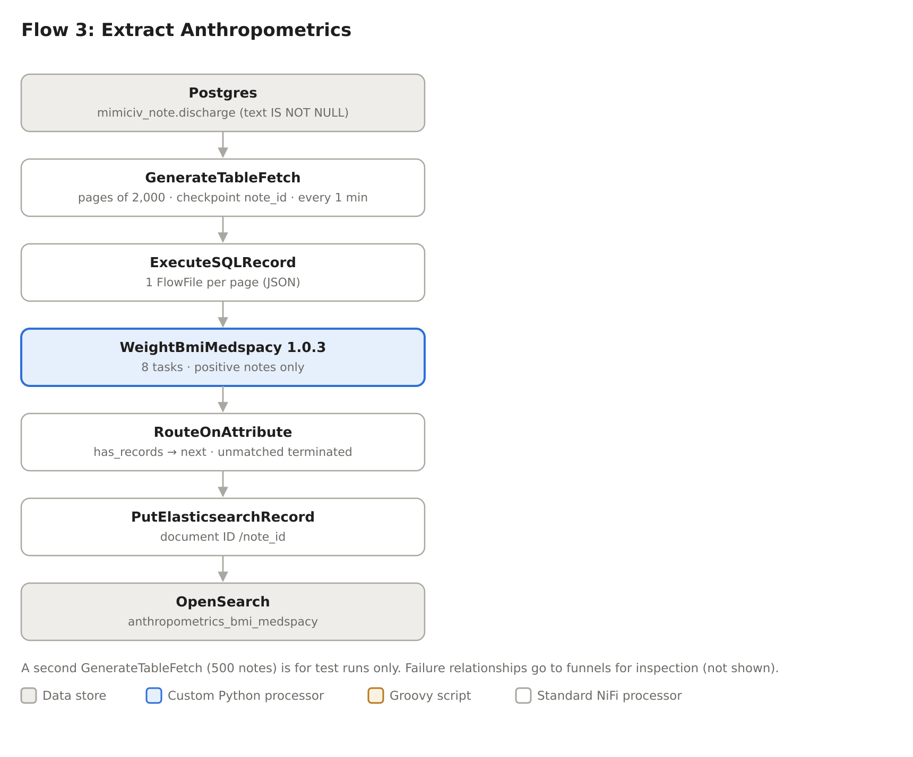

On the canvas after import, before any services are enabled:

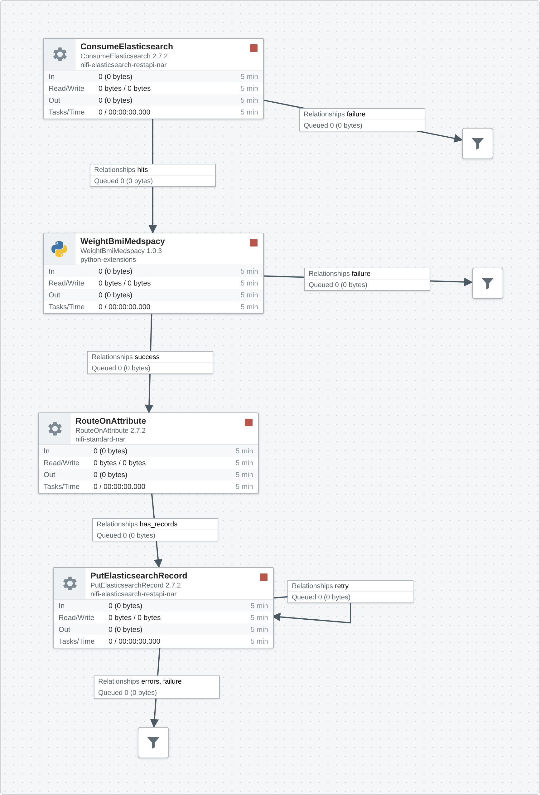

_Drawn from the processor positions and connections in the flow definition. Illustration, not a screenshot._

1. **GenerateTableFetch** reads `mimiciv_note.discharge` (`note_id, subject_id, hadm_id, text`, `WHERE text IS NOT NULL`) in pages of 2,000, every minute. Its checkpoint is the maximum `note_id`.
2. **GenerateTableFetch - For testing a few** is for test runs only. It runs the same query limited to 500 notes, via the table expression `(SELECT * FROM mimiciv_note.discharge LIMIT 500) AS discharge`, and feeds the same ExecuteSQLRecord.
3. **ExecuteSQLRecord** (2 tasks) writes one FlowFile per page (Max Rows Per Flow File = 0), as JSON.
4. **WeightBmiMedspacy 1.0.3** (8 tasks) has Text Field `text`, batch size 50, Emit Only Positive Notes `true` and BMI range 5–90.
5. **RouteOnAttribute** has `has_records = ${record.count:gt(0)}`. Pages with no positive notes go to `unmatched`, which is terminated, so they're discarded.
6. **PutElasticsearchRecord** writes to index `anthropometrics_bmi_medspacy`, with ID `/note_id` and Retain Record Path ID Field `true`. `retry` loops back to itself; `failure` and `errors` go to a funnel.

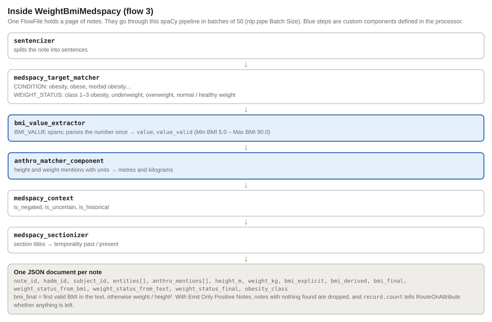

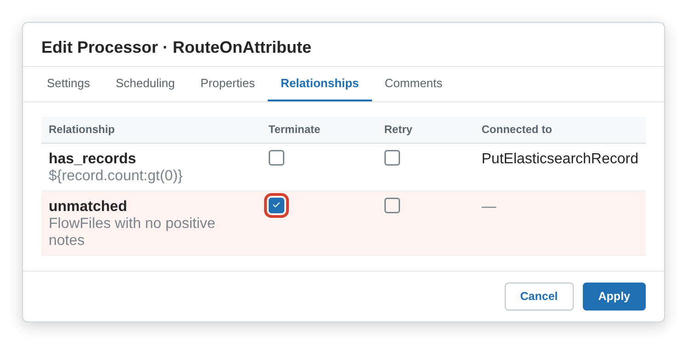

_RouteOnAttribute relationships in flow 3: unmatched is terminated. Illustration, not a screenshot._

**Before starting:**

- [ ] **Start only one GenerateTableFetch.** Use the testing one for a trial run, and the main one for the full load. Each keeps its own checkpoint.
- [ ] **Expect a long queue at first.** On the first run GenerateTableFetch queues every page at once (about 165 pages of 2,000 notes), and the flow then works through them. Back pressure is left at the default.
- [ ] **Watch memory on the first run.** Each of the 8 WeightBmiMedspacy tasks can be its own Python process, holding spaCy plus a 2,000-note page.

**Run:**

1. Start the testing GenerateTableFetch with everything downstream of it.
2. Check a few documents in `anthropometrics_bmi_medspacy`.
3. Stop the testing GenerateTableFetch and start the main one.

## Flow 4: Load anthropometrics to OMOP staging DB

This flow is the **compound entity** path. It reads flow 3's index and writes weight, height, BMI and obesity rows into the OMOP staging tables. Each weight and height measurement is stored as a compound entity: concept, value and unit rows linked through the relationship tables. BMI and obesity mentions are stored as atomic rows.


On the canvas after import, before any services are enabled:

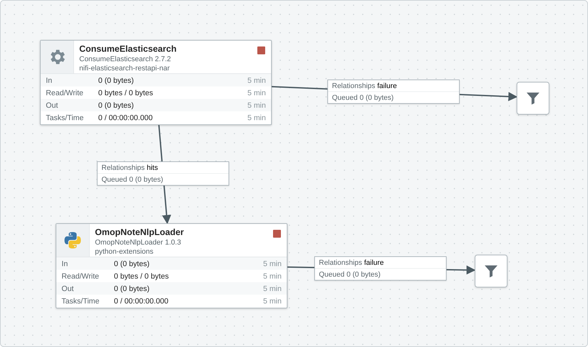

_Drawn from the processor positions and connections in the flow definition. Illustration, not a screenshot._

1. **ConsumeElasticsearch** reads index `anthropometrics_bmi_medspacy`, with Range Query Field `note_id.keyword` (ascending), in pages of 500, using scroll pagination and one FlowFile per page. It runs every minute on the primary node, with no Additional Filters.
2. **OmopNoteNlpLoader 1.0.3** connects to host `samples-db`, database `mimic`, as user `test`, with Target Schema `omop_temp` and Replace Existing Rows `false`. Each page loads in one transaction, and `note_nlp.note_id` is set to the note's `hadm_id`.

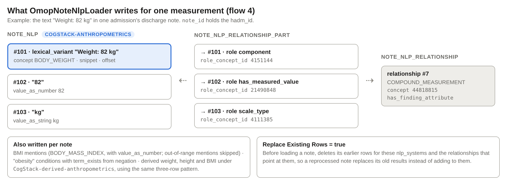

**Before starting:**

- [ ] **Enter the Database Password** on OmopNoteNlpLoader.
- [ ] **Let flow 3 finish its first full pass before starting this flow.** ConsumeElasticsearch only reads notes with a `note_id` higher than the last one it saw. Flow 3 indexes pages in parallel, so notes don't arrive in `note_id` order, and a note indexed after this flow has moved past its `note_id` would never be loaded. Once the backlog is done, new notes arrive in small batches and the risk is low. The proper fix is to track an indexing timestamp instead of `note_id`, which needs a `processed_at` field added to `WeightBmiMedspacy`.
- [ ] **Decide on Replace Existing Rows.** `false` appends, which is fine while each note is read once. Set it to `true` before any reload (after **View State → Clear State** on ConsumeElasticsearch); otherwise every row is written twice. Because there is one discharge note per admission, replacing rows by `hadm_id` is safe.


_ConsumeElasticsearch → View State, with Clear State. Illustration, not a screenshot._

**Check the result:**

```sql
SELECT nlp_system, count(*) FROM omop_temp.note_nlp GROUP BY 1;
SELECT count(*) FROM omop_temp.note_nlp_relationship;
```

To list compound entities with their parts:

```sql
SELECT r.relationship_id, n.note_id, p.role_source_value,
       n.lexical_variant, n.value_as_number, n.value_as_string
FROM omop_temp.note_nlp_relationship r
JOIN omop_temp.note_nlp_relationship_part p USING (relationship_id)
JOIN omop_temp.note_nlp n ON n.note_nlp_id = p.note_nlp_id
WHERE r.relationship_source_value = 'has_finding_attribute'
ORDER BY r.relationship_id, p.role_source_value
LIMIT 30;
```

## Flow 5: Load mental health mentions to OMOP staging DB

This flow is the **atomic entity** path. It streams MedCAT annotations from OpenSearch and writes one `note_nlp` row per mental health mention, with no relationship rows. It keeps only the CUIs listed in `cui_filter.txt`.


On the canvas after import, before any services are enabled:


_Drawn from the processor positions and connections in the flow definition. Illustration, not a screenshot._

1. **ConsumeElasticsearch** reads index `trext_medcat_annotations`, with Range Query Field `timestamp` (ascending) and Additional Filters `[{"range": {"timestamp": {"lt": "now-2m"}}}]`, which skips annotations less than 2 minutes old. It reads pages of **2,000** using scroll pagination, one FlowFile per page, and runs every 30 seconds on the primary node.
2. **MedcatNoteNlpLoader 1.2.0** is configured as follows:
   - Target Schema `omop_temp`, Note Lookup Table `mimiciv_note.discharge`, NLP System `MedCAT-v2-Snomed2025-MIMIC_IV`.
   - CUI Filter Mode `File`, with CUI Filter File `/opt/nifi/user_scripts/cui_filter.txt`. This is the only place the CUI filter is set.
   - The default Meta-annotation Rules, Default term_exists `Y`, and Skip Duplicates `true`.


_MedcatNoteNlpLoader properties in flow 5. Illustration, not a screenshot._


**Before starting:**

- [ ] **Enter the Database Password** on MedcatNoteNlpLoader.
- [ ] **Confirm `cui_filter.txt` is in the container.** If it's missing, the loader won't start; it reports a file-not-found error rather than loading everything.
- [ ] **Widen the delay while flow 2 works through its backlog.** Annotations are timestamped when MedCAT processes them, but during a backlog they can wait in flow 2's queues for more than 2 minutes before being indexed. Any annotation indexed after this flow has passed its timestamp is missed. During the first load, use for example `now-30m`, or start this flow only after flow 2 has finished.
- [ ] **Check the model's Status values** against the Meta-annotation Rules. The `medcat.unmapped_meta_values` attribute on the loader's output lists any value that has no rule.

**To change the CUI list later:**

1. Update `cui_filter.txt` in the container.
2. Stop and start the loader, so it rereads the file.
3. If you added CUIs, stop ConsumeElasticsearch, **View State → Clear State**, and start it again. This re-streams older annotations, and Skip Duplicates prevents duplicate rows.

