# CogStack NiFi 2.0 workflows: setup guide

**Tested with:** NiFi 2.7.2 in the `cogstacksystems/cogstack-nifi` image, Python 3.11, OpenSearch, and a CogStack-NiFi checkout whose `deploy/Makefile` has `start-data-infra` (and no `init-security` targets). The data is MIMIC-IV discharge notes, which you need your own PhysioNet credentialed access to use; this repository contains no MIMIC data.

**In this repository:**

```
cogstack-nifi/                     copy into a CogStack-NiFi checkout (same folder names)
  nifi/user_python_extensions/     WeightBmiMedspacy, OmopNoteNlpLoader, MedcatNoteNlpLoader
  nifi/user_scripts/               flow 1 Groovy scripts, cui_filter.txt
  nifi/user_schemas/               document-mimic.avsc
  nifi/user_templates/flows/       the five flow definitions to import
  services/pgsamples/mimiciv/sql/  discharge_binary.sql
notebooks/                         generate_mimic_iv_binary_samples.ipynb
docs/                              TRExt Deployment Guide section
images/                            figures for this guide
CHANGELOG.md
```

## Contents

1. [Overview](#overview)
2. [Before you start](#before-you-start)
3. [Installing the external files](#installing-the-external-files)
4. [Importing a flow and finishing its setup](#importing-a-flow-and-finishing-its-setup)
5. [Flow 1: Ingest binary docs to OpenSearch](#flow-1-ingest-binary-docs-to-opensearch)
6. [Flow 2: Ingest annotations to OpenSearch - Refined](#flow-2-ingest-annotations-to-opensearch---refined)
7. [Flow 3: Extract Anthropometrics](#flow-3-extract-anthropometrics)
8. [Flow 4: Load anthropometrics to OMOP staging DB](#flow-4-load-anthropometrics-to-omop-staging-db)
9. [Flow 5: Load mental health mentions to OMOP staging DB](#flow-5-load-mental-health-mentions-to-omop-staging-db)
10. [Appendix: about the images](#appendix-about-the-images)

## Overview

This guide covers five NiFi 2.7.2 flow definitions. Together they take MIMIC-IV discharge notes from Postgres, index them in one OpenSearch index (`discharge_summaries`), run two NLP pipelines over that index (MedCAT and medspaCy), and load the results into the OMOP staging schema `omop_temp`. Four of the flows use custom Python processors (five in total), and flow 1 uses three Groovy scripts. None of these files are inside the flow definitions, so they must be installed before you import.

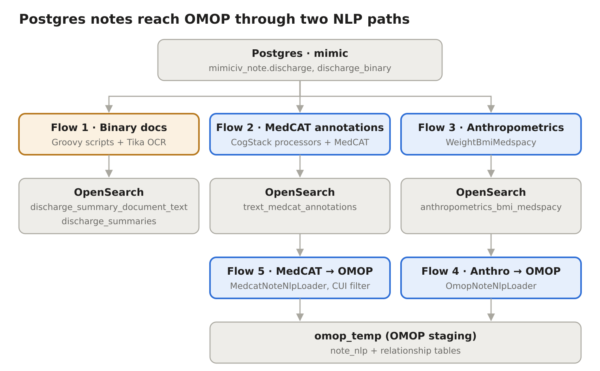

_Grey boxes are configurable data stores, blue boxes are flows built on custom Python processors, and the orange box is the flow built on Groovy scripts._

### Atomic and compound NLP entities

The two NLP paths load different kinds of entity into OMOP:

- **Atomic entities (MedCAT: flows 2 → 5).** Each mention is a single concept, such as a SNOMED CT finding, written as one `note_nlp` row. Its meta-annotations become `term_exists` (Y/N) and `term_temporal`. This path writes nothing to the relationship tables.
- **Compound entities (medspaCy: flows 3 → 4).** A measurement has several parts: the concept (body weight), its value (82) and its unit (kg). Each part is its own `note_nlp` row. A `note_nlp_relationship` row of type `COMPOUND_MEASUREMENT` groups them, with one `note_nlp_relationship_part` row per part giving its role (`component`, `has_measured_value` or `scale_type`). This path also writes atomic rows: BMI mentions (with `value_as_number`), "obesity" mentions, and the derived BMI.

So only flow 4 writes to the relationship tables. To read a compound entity back, join through them (see [Flow 4](#flow-4-load-anthropometrics-to-omop-staging-db)).

| # | Flow (process group name) | Reads | Writes | Custom components |
| --- | --- | --- | --- | --- |
| 1 | Ingest binary docs to OpenSearch | `mimiciv_note.discharge_binary` (PDF/DOCX), `mimiciv_note.discharge` | OpenSearch `discharge_summaries` (both sources, one document per `note_id`) | 3 Groovy scripts, 1 Avro schema, OCR service |
| 2 | Ingest annotations to OpenSearch - Refined | OpenSearch `discharge_summaries` | OpenSearch `trext_medcat_annotations` | `CogStackPrepareRecordForNlp`, `CogStackParseCogStackServiceResult` (0.0.1), MedCAT service |
| 3 | Extract Anthropometrics | OpenSearch `discharge_summaries` | OpenSearch `anthropometrics_bmi_medspacy` | `WeightBmiMedspacy` 1.0.3 |
| 4 | Load anthropometrics to OMOP staging DB | OpenSearch `anthropometrics_bmi_medspacy` | `omop_temp.note_nlp` + relationship tables | `OmopNoteNlpLoader` 1.0.3 |
| 5 | Load mental health mentions to OMOP staging DB | OpenSearch `trext_medcat_annotations` | `omop_temp.note_nlp` | `MedcatNoteNlpLoader` 1.3.0, `cui_filter.txt` |

**Run order.** Flows 2 and 3 read flow 1's index, flow 4 reads flow 3's, and flow 5 reads flow 2's. Set up in this order:

1. Install the external files.
2. Import all five flows.
3. With the stack running (`make start-data-infra`), start flow 1.
4. Start flows 2 and 3 once `discharge_summaries` has data.
5. Start flows 4 and 5 once their source indexes have data.

The flows keep running side by side after that. Each one picks up what the flow before it has added or replaced since its last run (see [How the flows read incrementally](#how-the-flows-read-incrementally)).

## Before you start

The flows were exported from NiFi **2.7.2** running in the CogStack NiFi container (`cogstack-nifi`). Import them into the same NiFi version. A different 2.x version usually works, but the standard processors may show version warnings until you change them.

- [ ] **The stack is running.** On a new checkout, generate the [OpenSearch certificates](#opensearch-certificates) first: OpenSearch won't start without them. Then, from the CogStack-NiFi repository's `deploy` folder (the one with the Makefile), run:

  ```bash
  make start-data-infra
  ```

  This starts everything the five flows need, each with its own `start-…` target if you need to restart one part:

  | Make target | Containers | Used by |
  | --- | --- | --- |
  | `start-nifi` | `cogstack-nifi`, `cogstack-nifi-nginx`, `cogstack-nifi-registry-flow` | all flows; NiFi UI at `https://localhost:8443/nifi` |
  | `start-elastic` | `elasticsearch-1`, `elasticsearch-2`, `cogstack-kibana` (OpenSearch Dashboards, port 5601) | all flows |
  | `start-samples` | `cogstack-samples-db` (Postgres, host port 5554), pgAdmin (port 5566) | flow 1 reads, flows 4 and 5 write |
  | `start-medcat-service` | the MedCAT service | flow 2 |
  | `start-ocr-services` | `ocr-service`, `ocr-service-text-only` | flow 1 |
  | `start-jupyterlab`, `start-label-studio` | JupyterLab, Label Studio | not used by the flows; JupyterLab can run the sample generator notebook |

  To stop everything, run `make stop-data-infra`.

- [ ] **These hostnames resolve from the NiFi container:**
  - `samples-db:5432` (Postgres, database `mimic`: flow 1 reads it, flows 4 and 5 write to it)
  - `elasticsearch-1:9200` and `elasticsearch-2:9200` (OpenSearch, HTTPS)
  - `ocr-service:8090` (Tika OCR, flow 1)
  - `cogstack-medcat-service-production:5000` (MedCAT, flow 2)
- [ ] **The OpenSearch certificates exist** in `security/certificates/elastic/opensearch/elasticsearch/elasticsearch-1/`. The flows' SSL Context Service uses `elasticsearch-1-keystore.jks` and `elasticsearch-1-truststore.key` (a JKS file despite its name) from `/security/…`, which is that host folder mounted read-only. If they're missing, see [OpenSearch certificates](#opensearch-certificates).
- [ ] **Credentials are to hand:** Postgres user `test`, OpenSearch user `admin`, and their passwords. Flow definitions never contain passwords.
- [ ] **The OMOP staging DB has been initialised.** Its initialisation scripts create `note_nlp`, `note_nlp_relationship` and `note_nlp_relationship_part` in `omop_temp`, with `note_nlp_concept_id` and `note_nlp_source_concept_id` as `bigint`. They also create the index the loaders use for their duplicate check:

  ```sql
  CREATE INDEX IF NOT EXISTS note_nlp_note_system_idx ON omop_temp.note_nlp (note_id, nlp_system);
  ```

  If your database was initialised before the index was added to the scripts, run the statement once by hand. It's safe to re-run (`IF NOT EXISTS`).

- [ ] **`mimiciv_note.discharge_binary` exists and holds complete documents.** Create it with `discharge_binary.sql` (or include that file in the databank's schema scripts), then fill it with `generate_mimic_iv_binary_samples.ipynb`: set `MODE = "new_sample"` and run all cells. The notebook writes each note as a multi-page PDF or a DOCX.
- [ ] **Python 3.11 is in the container**, which the CogStack image provides. The NumPy pin in `WeightBmiMedspacy` assumes 3.11.

### OpenSearch certificates

NiFi connects to OpenSearch over HTTPS, so the flows need the OpenSearch node certificates. They're generated for each deployment by the scripts in the repository's `security/` folder and aren't part of the flow files. Private keys never go into version control or into the workflow bundle.

**1. Check whether they already exist.** From `deploy/`:

```bash
ls -l ../security/certificates/root/
ls -l ../security/certificates/elastic/opensearch/elasticsearch/elasticsearch-1/
```

If `elasticsearch-1/` holds `elasticsearch-1.crt`, `.key`, `.p12`, `elasticsearch-1-keystore.jks` and `elasticsearch-1-truststore.key`, skip to step 3.

**2. Generate them.** Use whichever your checkout supports:

- **Newer CogStack-NiFi checkouts** have `init-security` targets in `deploy/Makefile` (check with `grep init-security Makefile`). From `deploy/`:

  ```bash
  make init-security-opensearch
  ```

  This creates the root CA if there isn't one, then the node certificates for `elasticsearch-1`, `-2` and `-3`, and the OpenSearch client and admin certificates. It leaves complete certificate sets unchanged, so it's safe to re-run.

- **Older checkouts** (no `init-security` targets) run the scripts directly. They use relative paths, so run them from `security/scripts/`:

  ```bash
  cd ../security/scripts
  ./create_root_ca_cert.sh                     # ONLY if ../certificates/root/ is empty
  ./create_opensearch_node_cert.sh elasticsearch-1 elasticsearch-2 elasticsearch-3
  ./create_opensearch_client_admin_certs.sh
  ```

**Don't create a new root CA on a deployment that already has one.** NiFi's own certificate and the PostgreSQL certificates are signed by the same CA, so replacing it means regenerating all of them. If another machine already runs this stack, copy its `security/certificates/` folder instead.

The node certificates are valid for the host names in `ES_NODE_SUBJ_ALT_NAMES` in `security/env/certificates_elasticsearch.env`, which already includes `elasticsearch-1` to `-3`, `nifi` and `localhost`. Add any other name you connect with before generating.

**3. Note the passwords** the flows need:

| Where in NiFi | Value | Set in (default) |
| --- | --- | --- |
| SSL Context Service: Keystore Password, Key Password, Truststore Password | the node certificate password | `ES_CERTIFICATE_PASSWORD` in `security/env/certificates_elasticsearch.env` (`cogstackNifi`) |
| Elasticsearch client service: Username / Password | the OpenSearch admin user | `ELASTIC_USER` / `ELASTIC_PASSWORD` in `security/env/users_elasticsearch.env` (`admin` / `admin`) |

Change the defaults for any real deployment. `ELASTIC_PASSWORD` must match the admin hash in `security/es_roles/opensearch/internal_users.yml`; the repository's `update_opensearch_users.sh` keeps them in step.

**4. Check and load them.**

```bash
# the chain is valid
openssl verify -CAfile ../security/certificates/root/root-ca.pem \
  ../security/certificates/elastic/opensearch/elasticsearch/elasticsearch-1/elasticsearch-1.crt

# the keystore opens with the password from step 3
keytool -list -keystore ../security/certificates/elastic/opensearch/elasticsearch/elasticsearch-1/elasticsearch-1-keystore.jks

# NiFi can see them
docker exec cogstack-nifi ls -l /security/certificates/elastic/opensearch/elasticsearch/elasticsearch-1/
```

After generating new certificates, restart OpenSearch so the nodes use them (`make start-elastic`). In NiFi, disable and re-enable each SSL Context Service, which rereads the keystore.


## Installing the external files

A flow definition records only the *paths* and *processor versions* it uses, not the files themselves. Put every file below at exactly this path inside the NiFi container before importing. Otherwise the processors import as invalid, or as missing in the case of Python processors.

| File | Used by | Path in the container |
| --- | --- | --- |
| `weight_and_bmi_medspacy_extraction.py` (processor `WeightBmiMedspacy` **1.0.3**) | Flow 3 | `/opt/nifi/nifi-current/python_extensions/` |
| `omop_note_nlp_loader.py` (processor `OmopNoteNlpLoader` **1.0.3**) | Flow 4 | `/opt/nifi/nifi-current/python_extensions/` |
| `medcat_omop_note_nlp_loader.py` (processor `MedcatNoteNlpLoader` **1.3.0**) | Flow 5 | `/opt/nifi/nifi-current/python_extensions/` |
| `CogStackPrepareRecordForNlp`, `CogStackParseCogStackServiceResult` (**0.0.1**) | Flow 2 | Ship with the CogStack NiFi image. If missing, copy them from the CogStack-NiFi repository into the same folder. |
| `prepare-db-record-for-tika-request-single-mimic.groovy` | Flow 1 | `/opt/nifi/user_scripts/` |
| `parse-tika-response-single-mimic.groovy` | Flow 1 | `/opt/nifi/user_scripts/` |
| `parse-tika-result-json-to-avro-mimic.groovy` | Flow 1 | `/opt/nifi/user_scripts/` |
| `document-mimic.avsc` (Avro schema) | Flow 1 | `/opt/nifi/user_schemas/` |
| `cui_filter.txt` | Flow 5 | `/opt/nifi/user_scripts/` |
| `postgresql-42.7.7.jar` (JDBC driver) | Flow 1 | `/opt/nifi/drivers/` |

**Flow 1's scripts and schema must be the combined-output versions** (November 2026). They write the same fields as `mimiciv_note.discharge`, plus the OCR metadata. Older versions write `doc_id` and `doc_text` and fail with the current flow. All the files in the table are in this repository's [`cogstack-nifi/`](cogstack-nifi/) folder, in the same folders as a CogStack-NiFi checkout, so you can copy `cogstack-nifi/nifi/` over the checkout's `nifi/` folder. `discharge_binary.sql` is in [`cogstack-nifi/services/pgsamples/mimiciv/sql/`](cogstack-nifi/services/pgsamples/mimiciv/sql/), the sample generator notebook is in [`notebooks/`](notebooks/), and the five flow definitions to import are in [`cogstack-nifi/nifi/user_templates/flows/`](cogstack-nifi/nifi/user_templates/flows/).

**File names and processor names differ.** NiFi identifies a Python processor by the class name inside the file (`WeightBmiMedspacy`, `OmopNoteNlpLoader`, `MedcatNoteNlpLoader`), not by the file name. That class name is what you search for in the Add Processor dialog and what the flow definitions refer to. It's also the name of each processor's dependency folder under `/opt/nifi/user_scripts/extensions/`. Keep exactly one file per processor in the extensions folder. If a renamed copy and an old copy both define the same class, NiFi lists the processor twice.


### Step 1: Copy the files into the repository's nifi folders

`services.yml` mounts all four container folders from the repository, so you copy the files on the host, not into the container. Files put there survive `make start-nifi`, which recreates the NiFi container (`--force-recreate`).

| Container path | Host folder (from `deploy/`) |
| --- | --- |
| `/opt/nifi/nifi-current/python_extensions/` | `../nifi/user_python_extensions/` |
| `/opt/nifi/user_scripts/` | `../nifi/user_scripts/` |
| `/opt/nifi/user_schemas/` | `../nifi/user_schemas/` |
| `/opt/nifi/drivers/` | `../nifi/drivers/` |

From the `deploy` folder, with the files in a folder `$SRC`:

```bash
# Python processors
cp $SRC/weight_and_bmi_medspacy_extraction.py $SRC/omop_note_nlp_loader.py $SRC/medcat_omop_note_nlp_loader.py ../nifi/user_python_extensions/

# Groovy scripts and CUI filter
cp $SRC/prepare-db-record-for-tika-request-single-mimic.groovy $SRC/parse-tika-response-single-mimic.groovy \
   $SRC/parse-tika-result-json-to-avro-mimic.groovy $SRC/cui_filter.txt ../nifi/user_scripts/

# Avro schema and JDBC driver
cp $SRC/document-mimic.avsc ../nifi/user_schemas/
cp $SRC/postgresql-42.7.7.jar ../nifi/drivers/

# Make everything readable by the NiFi user (UID 1000 by default)
chmod -R a+rX ../nifi/user_python_extensions ../nifi/user_scripts ../nifi/user_schemas ../nifi/drivers
```

To check the container sees them:

```bash
docker exec cogstack-nifi bash -c 'ls -l /opt/nifi/nifi-current/python_extensions /opt/nifi/user_scripts /opt/nifi/user_schemas /opt/nifi/drivers'
```

### Step 2: Restart NiFi and let the Python dependencies install

```bash
docker restart cogstack-nifi     # or: make start-nifi
```

NiFi discovers the new Python processors when it starts. The first time each processor is used, NiFi pip-installs its dependencies into `/opt/nifi/user_scripts/extensions/<Processor>/<version>/`, which is `../nifi/user_scripts/extensions/` on the host, so they also survive the container being recreated:

- `WeightBmiMedspacy` installs medspaCy, spaCy and a NumPy version below 2. This takes several minutes.
- The two loaders install only `psycopg2-binary`.

Watch progress with:

```bash
docker exec cogstack-nifi tail -f /opt/nifi/nifi-current/logs/nifi-app.log
```

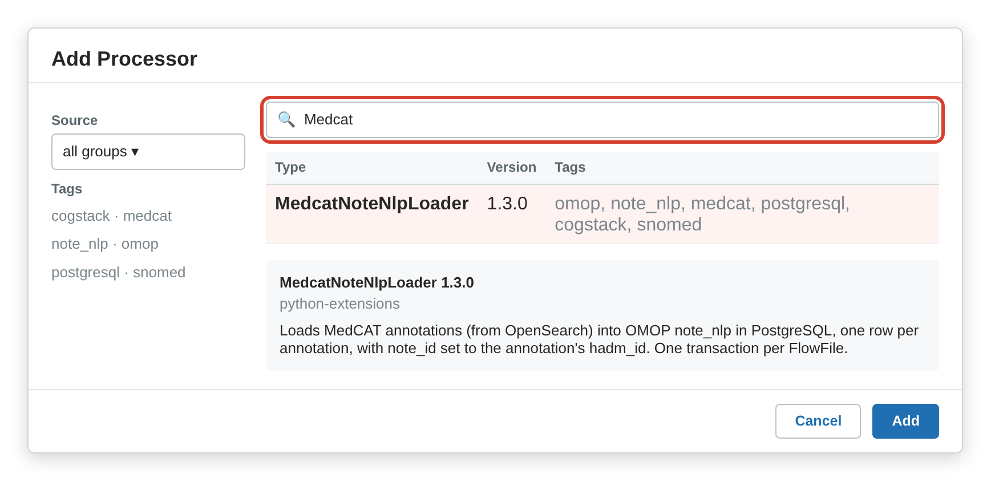

_Add Processor dialog filtered to "Medcat", showing MedcatNoteNlpLoader 1.3.0. Illustration, not a screenshot._

### Versions must match

Each flow records the exact version of each processor it uses. If the `.py` file you installed (for example `medcat_omop_note_nlp_loader.py`) declares a different `version` in its `ProcessorDetails`, the processor imports as missing. Right-click it → **Change Version** and pick the installed version.


_Right-click → Change Version, and picking the installed version. Illustration, not a screenshot._

The Groovy scripts, CUI filter and Avro schema don't need a NiFi restart. Each is read when its processor starts, so after editing one, stop and start that processor.

### Cleaning up old dependency folders

Every version bump leaves the previous dependency folder behind. To remove them, run `clean_old_extension_versions.sh` with all three processors in its `PROCESSORS` list. Use the class names, not the file names. The script finds each processor's file by its class name, so your file names don't matter:

```bash
PROCESSORS="WeightBmiMedspacy OmopNoteNlpLoader MedcatNoteNlpLoader"
```

## Importing a flow and finishing its setup

Repeat these steps for each JSON file.

1. **Import.** Drag the **Process Group** icon from the top toolbar onto the canvas. Click the upload icon next to the Name field, choose the `.json` file, then click **Add**.

   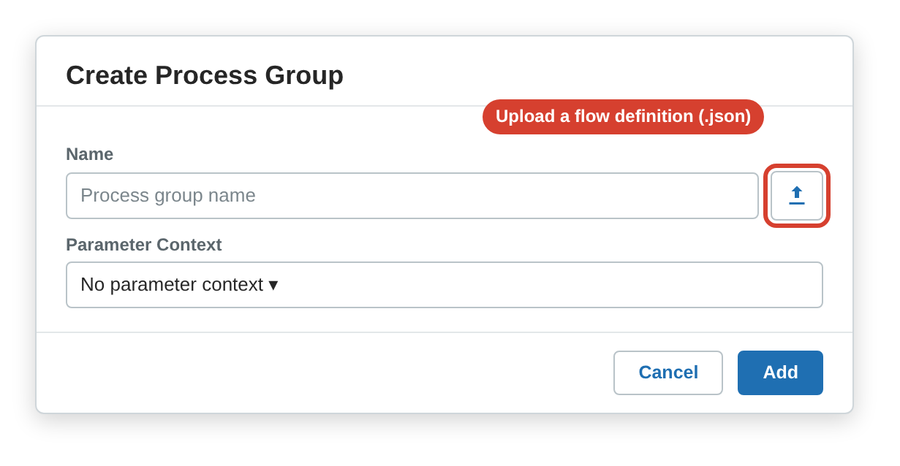

   _Create Process Group dialog, with the upload icon for a flow definition. Illustration, not a screenshot._

2. **Re-enter the passwords.** Flow definitions never carry sensitive values. Open the group, right-click empty canvas → **Controller Services**, and fill in:

   | Service or processor | Blank sensitive properties | In flows |
   | --- | --- | --- |
   | StandardSSLContextService | Keystore Password, Key Password, Truststore Password | 1 (two copies), 2, 3, 4, 5 |
   | ElasticSearchClientServiceImpl | Password (user `admin`) | 1, 2, 3, 4, 5 |
   | DBCPConnectionPool | Password (user `test`) | 1 (top group and the "Ingest free-text documents from DB" subgroup) |
   | `OmopNoteNlpLoader` / `MedcatNoteNlpLoader` processor | Database Password | 4 / 5 |

   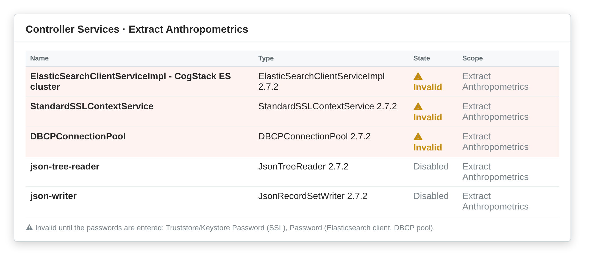

   _Controller Services in flow 3 straight after import, before passwords are entered. Illustration, not a screenshot._

3. **Enable the services.** Enable each SSL Context Service first, because the Elasticsearch client depends on it. Then enable the Elasticsearch client, any DBCP pool and the record readers and writers. Every processor should now show a red stop square, not a yellow warning.
4. **Check the Python processors.** A processor that shows as missing or ghosted means its `.py` file isn't installed, or is installed at a different version (see [Versions must match](#versions-must-match)).
5. **Don't start anything yet.** Each flow's section below lists what to check first. Imported processors start with no state, so GenerateTableFetch and ConsumeElasticsearch read their sources from the beginning.
6. **Check the index names.** Each flow writes to, or reads from, the index names in the table in the [Overview](#overview). If you test with temporary names (for example `trext_medcat_annotations_dev`), change the reading flow to match, and switch both back before the full run.

**With or without external services.** If a flow was exported *with* external services, it brings its own copy of "ElasticSearchClientServiceImpl - CogStack ES cluster" and its SSL Context Service. Importing several flows like that leaves several copies, and a password change then means updating each one. To keep a single copy:

1. Create the client and SSL service once, at the top level of the canvas (right-click empty canvas at the root → Controller Services).
2. Point each processor's **Client Service** at it.
3. Delete the copies inside the groups.

If a flow was exported *without* external services, NiFi links it to a compatible service in a parent group automatically, as long as there is exactly one. Otherwise the processor shows as invalid until you select one.

To reuse the flows across environments, move hostnames, schemas and passwords into a **Parameter Context**. Use sensitive parameters for the passwords, and reference each parameter as `#{name}`.

### How the flows read incrementally

Each flow's first processor keeps a checkpoint in NiFi state, so it reads only what is new on each run. An imported flow has no state, so it starts from the beginning. To re-read everything later, stop the processor, right-click → **View State → Clear State**, and start it again.


Flows 2 and 3 track `indexed_at`, which flow 1 stamps on every document it writes. A note that flow 1 replaces (for example, the OCR version replacing the free-text one) gets a new `indexed_at`, so flows 2 and 3 process it again and overwrite their output for that note. If the new text gives a note fewer MedCAT annotations than before, the extra old annotations stay in `trext_medcat_annotations`.

**Testing on a few patients.** To try flows 2 and 3 on a small subset first, add a second filter to Additional Filters on their ConsumeElasticsearch processors. For example, this reads about 0.1% of patients:

```json
[{"range": {"indexed_at": {"lt": "now-5m"}}}, {"range": {"subject_id": {"lt": 10010000}}}]
```

When the test is done, set Additional Filters back to the indexed_at filter alone, then **View State → Clear State** and start the processor again.

**About the failure funnels.** Every flow sends failures to funnels with no outgoing connection, so failed FlowFiles wait there for you to inspect. Those queues have back pressure too (10,000 FlowFiles by default), and if one fills up, the processor feeding it stops. Check them now and then: inspect or replay what's there, then right-click the connection → **Empty Queue**.

## Flow 1: Ingest binary docs to OpenSearch

This flow loads every discharge note into one OpenSearch index, `discharge_summaries`, from two sources: binary documents (PDF and DOCX) that go through the Tika OCR service, and the free-text notes copied as they are. Both write one document per `note_id` with the same fields, so flows reading the index don't need to know where a note came from.


The group holds two subgroups and the shared services (Elasticsearch client, SSL context, Avro reader and writer, DBCP pool):

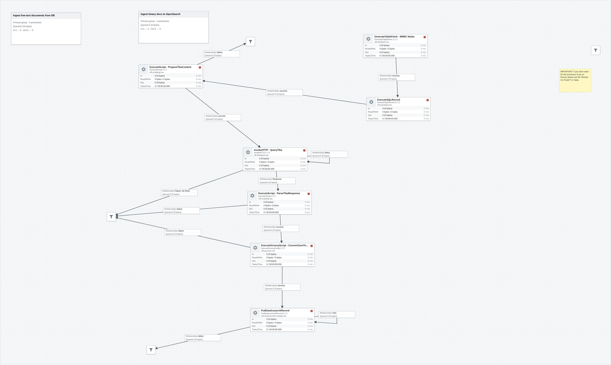

_Drawn from the processor positions and connections in the flow definition. Illustration, not a screenshot._

**Subgroup "Ingest binary docs to OpenSearch" (OCR):**

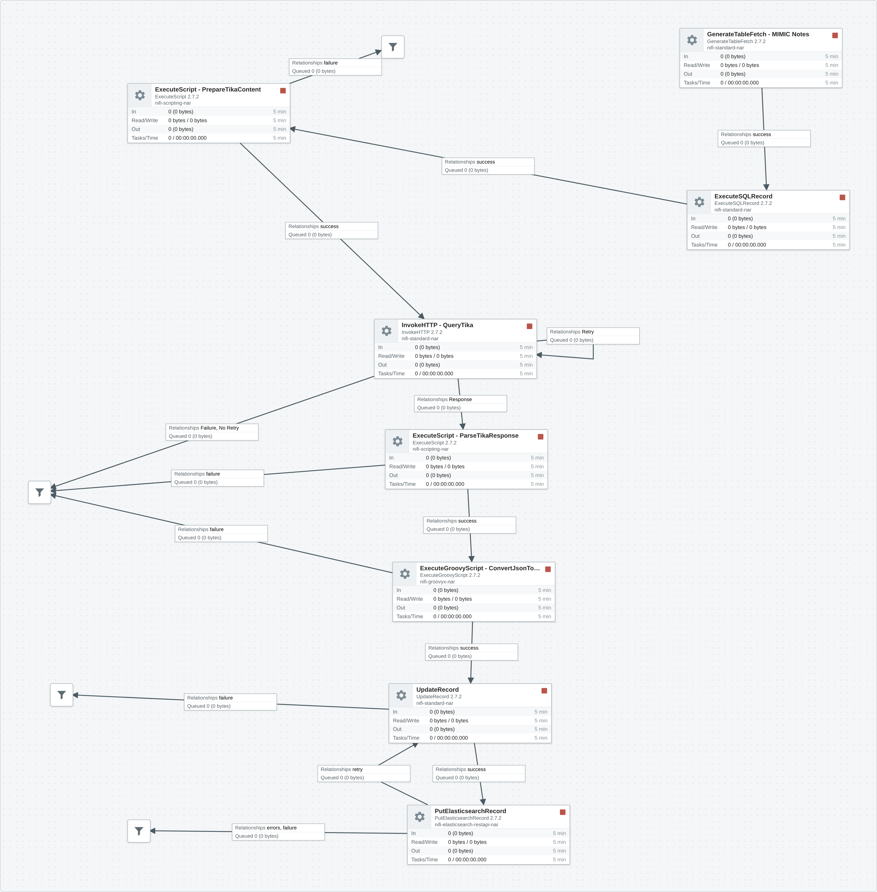

1. **GenerateTableFetch - MIMIC Notes** reads `mimiciv_note.discharge_binary` (`note_id, subject_id, hadm_id, note_type, note_seq, charttime, storetime, file_mime, file_data`) in pages of 3,000. Its checkpoint is the maximum `charttime`, and pages are partitioned on `hadm_id`.
2. **ExecuteSQLRecord** (5 tasks) writes one row per FlowFile, as Avro. The scripts need exactly one record per FlowFile, so keep Max Rows Per Flow File at `1`.
3. **ExecuteScript - PrepareTikaContent** runs `prepare-db-record-for-tika-request-single-mimic.groovy`, with one property, `binary_field = file_data`. The document bytes become the FlowFile content, and every other column is kept as an attribute named `src.<column>`.
4. **InvokeHTTP - QueryTika** (2 tasks) sends `POST http://ocr-service:8090/api/process`, with a 600-second read timeout. `Retry` loops back to itself; `No Retry` and `Failure` go to a funnel.
5. **ExecuteScript - ParseTikaResponse** runs `parse-tika-response-single-mimic.groovy`. It combines the OCR text with the `src.*` columns.
6. **ExecuteGroovyScript - ConvertJsonToAvro** runs `parse-tika-result-json-to-avro-mimic.groovy` with the schema `/opt/nifi/user_schemas/document-mimic.avsc`. The record has the free-text fields (`note_id` … `text`, with the OCR text in `text`) plus `processing_timestamp` and `metadata_*` (content type, page count, OCR confidence, elapsed time).
7. **UpdateRecord** adds `indexed_at`, the current time in UTC: `${now():format("yyyy-MM-dd'T'HH:mm:ss.SSS'Z'", "GMT")}`, using the shared Avro reader and writer.
8. **PutElasticsearchRecord** writes to `discharge_summaries`, ID `/note_id`, in batches of 100.

**Subgroup "Ingest free-text documents from DB":**


GenerateTableFetch on `mimiciv_note.discharge` (pages of 5,000, checkpoint `charttime`) → ExecuteSQLRecord (one FlowFile per page) → UpdateRecord (`indexed_at`, as above) → PutElasticsearchRecord into `discharge_summaries`, ID `/note_id`, in batches of 200. It has its own DBCP pool and uses the parent group's Avro reader and writer.

**Both PutElasticsearchRecord processors** use the same relationship settings:

| Relationship | Setting |
| --- | --- |
| `successful`, `original` | Terminate |
| `failure`, `errors` | To the failure funnel. Nothing is ticked under Retry, because a rejected document is rejected again. |
| `retry` | Back to **UpdateRecord**, so documents wait out an OpenSearch outage and are stamped again on each attempt |

Log Error Responses is on, so rejected documents appear in `nifi-app.log` with OpenSearch's reason.

**`indexed_at`** is how flows 2 and 3 find new and replaced documents: their ConsumeElasticsearch reads documents with an `indexed_at` later than the last one it saw. Each write stamps the time again, including retries. OpenSearch maps the field as a date the first time it sees it. Documents written before this field existed have no `indexed_at`; reload them by clearing the state of both GenerateTableFetch processors. To check the field:

```bash
curl -k -u admin:<password> "https://elasticsearch-1:9200/discharge_summaries/_count?q=NOT%20_exists_:indexed_at"   # should be 0
```

**One document per note.** A note in both tables is written twice with the same `note_id`, and the later write replaces the earlier one. The OCR branch is slower, so for notes in both tables the OCR version usually ends up in the index. To see which source a document came from, check for OCR fields:

```bash
curl -k -u admin:<password> "https://elasticsearch-1:9200/discharge_summaries/_count?q=_exists_:processing_timestamp"
```

**Before starting:**

- [ ] **Set Run Schedule on both GenerateTableFetch processors**, for example to `1 min`. At `0 sec` they query Postgres continuously, even when nothing has changed.
- [ ] **Check the OCR service responds.** This should print a status code, not a connection error:

  ```bash
  docker exec cogstack-nifi curl -s -o /dev/null -w '%{http_code}\n' http://ocr-service:8090/
  ```

- [ ] **Consider Output Batch Size `100`** on the OCR ExecuteSQLRecord, so Tika starts on documents while the rest of the page is still being read.
- [ ] **Route the OCR ExecuteSQLRecord's `failure` to a funnel.** It's auto-terminated, which silently discards it.

**Run:** start both subgroups. Check progress with:

```bash
curl -k -u admin:<password> https://elasticsearch-1:9200/discharge_summaries/_count
```

**Rebuilding the binary documents.** After `generate_mimic_iv_binary_samples.ipynb` rewrites `discharge_binary`, stop **GenerateTableFetch - MIMIC Notes**, **View State → Clear State**, and start it again. The rows keep their `charttime`, so without clearing state the flow won't read them.

**If OpenSearch drops connections** (`Connection reset` in the bulletins), the bulk requests are too large for its heap. Lower Batch Size, run one task, and check the node with `_cat/nodes?v&h=name,heap.percent,heap.max`. Then replay the failure funnel by connecting it to **UpdateRecord**, so replayed documents get a fresh `indexed_at`, until it empties. Documents are written by `note_id`, so a replay never duplicates them.

## Flow 2: Ingest annotations to OpenSearch - Refined

This flow reads discharge notes from `discharge_summaries`, sends them to the MedCAT service in bulk, and indexes one OpenSearch document per annotation, keyed by `annotation_id`.


On the canvas after import, before any services are enabled:


_Drawn from the processor positions and connections in the flow definition. Illustration, not a screenshot._

1. **ConsumeElasticsearch** reads `discharge_summaries` with these settings. It runs every minute on the primary node, and its `aggregations` and `retry` relationships are terminated (it has no FlowFile to retry); `failure` goes to a funnel.

   | Property | Value |
   | --- | --- |
   | Client Service | ElasticSearchClientServiceImpl - CogStack ES cluster |
   | Index | `discharge_summaries` |
   | Range Query Field / Sort Order | `indexed_at` / `asc` |
   | Additional Filters | `[{"range": {"indexed_at": {"lt": "now-5m"}}}]` |
   | Size | `1000` |
   | Pagination Type | scroll (`pagination-scroll`) |
   | Search Results Split | per response (`splitUp-no`): one FlowFile per page |
   | Search Results Format | Source only (`SOURCE_ONLY`): each FlowFile is a JSON array of notes |

2. **CogStackPrepareRecordForNlp** (25 tasks) builds the MedCAT request: `document_id_field_name = note_id`, `document_text_field_name = text`, `process_flow_file_type = json`.
3. **InvokeHTTP** sends `POST http://cogstack-medcat-service-production:5000/api/process_bulk`, with 600-second timeouts. Any failure goes to a **second InvokeHTTP** for one more attempt; that one's failures go to a funnel.
4. **CogStackParseCogStackServiceResult** (`service_message_type = medcat`, `document_id_field_name = note_id`) parses the MedCAT response. As with InvokeHTTP, failures get a second attempt in a duplicate processor.
5. **SplitJson** (`$.*`) splits the result into one FlowFile per annotation.
6. **EvaluateJsonPath** (80 tasks) copies `$.annotation_id` into an attribute.
7. **PutElasticsearchJson** writes to index `trext_medcat_annotations`, with the document ID taken from the `annotation_id` attribute and Index Operation `index`. `retry` loops back to itself; `failure` and `errors` go to a funnel.

**What each annotation contains.** The parser copies every field of the source note except `text` into each annotation, so annotations carry `note_id`, `subject_id`, `hadm_id`, `charttime` and the rest alongside MedCAT's own fields (`cui`, `pretty_name`, `start`, `end`, `meta_anns`, `timestamp` and so on). `annotation_id` is `<note_id>_<n>`, so reprocessing a note overwrites its annotations rather than duplicating them. Flow 5 takes `hadm_id` straight from the annotation.

**All three CogStack processors must use `note_id`.** If any is left at `id` (the setting when the flow read from Postgres), annotation IDs no longer match the note, and the parser can't find the document it's parsing.

**Before starting:**

- [ ] **Check the index name** on PutElasticsearchJson is `trext_medcat_annotations`, the index flow 5 reads.
- [ ] **Check PutElasticsearchJson's Client Service** is "ElasticSearchClientServiceImpl - CogStack ES cluster". If you deleted a duplicate client, the processor may still point at the deleted one and show as invalid.
- [ ] **Check the MedCAT service responds:**

  ```bash
  docker exec cogstack-nifi curl -s http://cogstack-medcat-service-production:5000/api/info
  ```

- [ ] **Keep "Request Body Enabled" set to `true`** on both InvokeHTTP processors, as the canvas label says. The notes must be sent as JSON.
- [ ] **On PutElasticsearchJson, set Batch Size to about `1000`, Log Error Responses to `true` and Bulletin Level to WARN.** Batches of 10,000 annotations are about as large as the bulk requests that made OpenSearch reset connections in flow 1. With errors logged, rejected annotations show up in `nifi-app.log` with OpenSearch's reason.
- [ ] **If InvokeHTTP keeps timing out** after 600 seconds, lower ConsumeElasticsearch's Size, for example to 500.

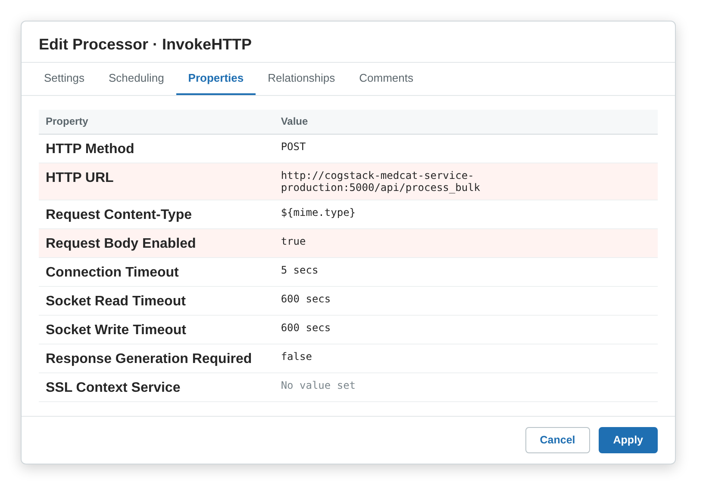

_InvokeHTTP properties in flow 2. Illustration, not a screenshot._

**Run:** start the group. Expect very large queue counts after SplitJson, because it creates one FlowFile per annotation (back pressure is set at 200,000). To check annotations have the note fields:

```bash
curl -k -u admin:<password> "https://elasticsearch-1:9200/trext_medcat_annotations/_search?size=1&q=_exists_:hadm_id&_source=annotation_id,note_id,hadm_id,cui&pretty"
```

## Flow 3: Extract Anthropometrics

This flow runs the medspaCy weight/BMI pipeline over every note in `discharge_summaries` and indexes the notes that have a weight status.


On the canvas after import, before any services are enabled:


_Drawn from the processor positions and connections in the flow definition. Illustration, not a screenshot._

1. **ConsumeElasticsearch** reads `discharge_summaries` with the same settings as in flow 2, except Size `2000`. Each FlowFile is a JSON array of up to 2,000 notes.
2. **WeightBmiMedspacy 1.0.3** (8 tasks) has Text Field `text`, batch size 50, Emit Only Positive Notes `true` and BMI range 5–90. The documents already carry `note_id`, `subject_id` and `hadm_id`, which it copies to its output.
3. **RouteOnAttribute** has `has_records = ${record.count:gt(0)}`. Pages with no positive notes go to `unmatched`, which is terminated, so they're discarded.
4. **PutElasticsearchRecord** writes to index `anthropometrics_bmi_medspacy`, with ID `/note_id`, Retain Record Path ID Field `true`, batches of 100 and Log Error Responses on. `retry` loops back to itself; `failure` and `errors` go to a funnel.


_RouteOnAttribute relationships in flow 3: unmatched is terminated. Illustration, not a screenshot._

**Before starting:**

- [ ] **Check the index name** on PutElasticsearchRecord is `anthropometrics_bmi_medspacy`, the index flow 4 reads.
- [ ] **Expect a long first run.** With no state, ConsumeElasticsearch reads all of `discharge_summaries`, in pages of 2,000.
- [ ] **Watch memory on the first run.** Each of the 8 WeightBmiMedspacy tasks can be its own Python process, holding spaCy plus a 2,000-note page.

**Run:**

1. Add the `subject_id` test filter (see [Testing on a few patients](#how-the-flows-read-incrementally)) and start the group.
2. Check a few documents in `anthropometrics_bmi_medspacy`, and the failure funnels.
3. Remove the test filter, **Clear State** on ConsumeElasticsearch, and start it again for the full load.

## Flow 4: Load anthropometrics to OMOP staging DB

This flow is the **compound entity** path. It reads flow 3's index and writes weight, height, BMI and obesity rows into the OMOP staging tables. Each weight and height measurement is stored as a compound entity: concept, value and unit rows linked through the relationship tables. BMI and obesity mentions are stored as atomic rows.

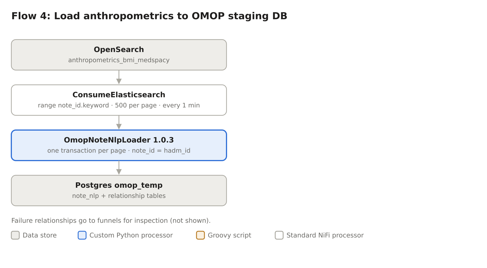

On the canvas after import, before any services are enabled:


_Drawn from the processor positions and connections in the flow definition. Illustration, not a screenshot._

1. **ConsumeElasticsearch** reads index `anthropometrics_bmi_medspacy`, with Range Query Field `note_id.keyword` (ascending), in pages of 500, using scroll pagination and one FlowFile per page. It runs every minute on the primary node, with no Additional Filters.
2. **OmopNoteNlpLoader 1.0.3** connects to host `samples-db`, database `mimic`, as user `test`, with Target Schema `omop_temp` and Replace Existing Rows `false`. Each page loads in one transaction, and `note_nlp.note_id` is set to the note's `hadm_id`.


**Before starting:**

- [ ] **Enter the Database Password** on OmopNoteNlpLoader.
- [ ] **Let flow 3 finish its first full pass before starting this flow.** ConsumeElasticsearch only reads notes with a `note_id` higher than the last one it saw. Flow 3 writes notes in the order flow 1 indexed them, not in `note_id` order, so a note indexed after this flow has moved past its `note_id` would never be loaded. Once the backlog is done, new notes arrive in small batches and the risk is low. The proper fix is the one flows 2 and 3 now use: stamp `indexed_at` with an UpdateRecord before flow 3's PutElasticsearchRecord, and track that field here instead of `note_id`.
- [ ] **Decide on Replace Existing Rows.** `false` appends, which is fine while each note is read once. Set it to `true` before any reload (after **View State → Clear State** on ConsumeElasticsearch); otherwise every row is written twice. Because there is one discharge note per admission, replacing rows by `hadm_id` is safe.

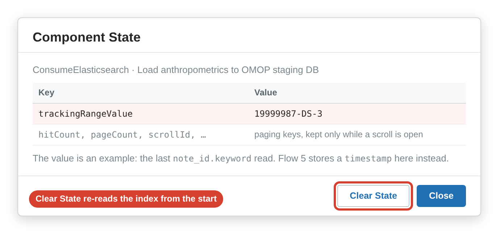

_ConsumeElasticsearch → View State, with Clear State. Illustration, not a screenshot._

**Check the result:**

```sql
SELECT nlp_system, count(*) FROM omop_temp.note_nlp GROUP BY 1;
SELECT count(*) FROM omop_temp.note_nlp_relationship;
```

To list compound entities with their parts:

```sql
SELECT r.relationship_id, n.note_id, p.role_source_value,
       n.lexical_variant, n.value_as_number, n.value_as_string
FROM omop_temp.note_nlp_relationship r
JOIN omop_temp.note_nlp_relationship_part p USING (relationship_id)
JOIN omop_temp.note_nlp n ON n.note_nlp_id = p.note_nlp_id
WHERE r.relationship_source_value = 'has_finding_attribute'
ORDER BY r.relationship_id, p.role_source_value
LIMIT 30;
```

## Flow 5: Load mental health mentions to OMOP staging DB

This flow is the **atomic entity** path. It streams MedCAT annotations from OpenSearch and writes one `note_nlp` row per mental health mention, with no relationship rows. It keeps only the CUIs listed in `cui_filter.txt`. `note_nlp.note_id` is set to the annotation's `hadm_id`.

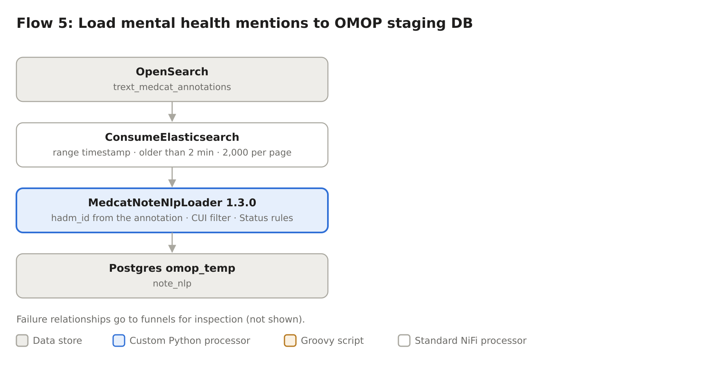

On the canvas after import, before any services are enabled:

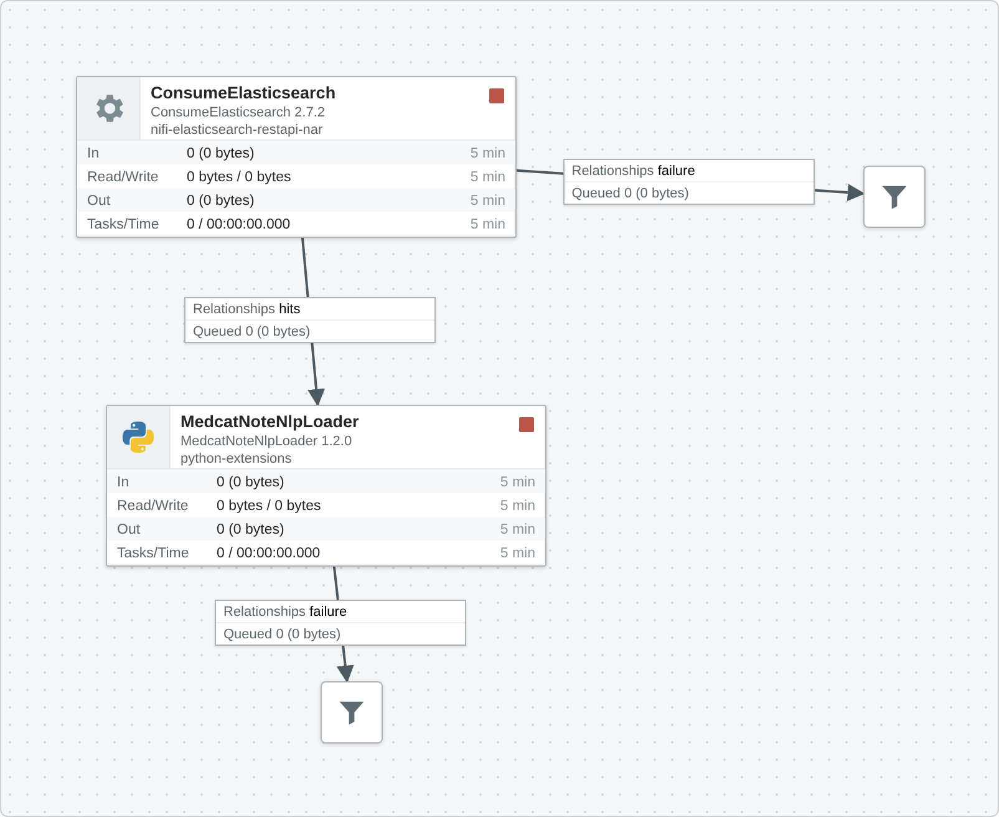

_Drawn from the processor positions and connections in the flow definition. Illustration, not a screenshot._

1. **ConsumeElasticsearch** reads index `trext_medcat_annotations`, with Range Query Field `timestamp` (ascending) and Additional Filters `[{"range": {"timestamp": {"lt": "now-2m"}}}]`, which skips annotations less than 2 minutes old. It reads pages of **2,000** using scroll pagination, one FlowFile per page, and runs every 30 seconds on the primary node.
2. **MedcatNoteNlpLoader 1.3.0** is configured as follows:
   - Target Schema `omop_temp`, NLP System `MedCAT-v2-Snomed2025-MIMIC_IV`.
   - Note Lookup Table `mimiciv_note.discharge`. Version 1.3.0 takes `hadm_id` from the annotation itself, which every annotation from the current flow 2 has. It only looks up `note_id` (or the older `id`) in this table for annotations without one, such as those indexed when flow 2 still read from Postgres. Annotations it can't map are skipped and counted in the `medcat.skipped_unmapped_hadm_id` attribute.
   - CUI Filter Mode `File`, with CUI Filter File `/opt/nifi/user_scripts/cui_filter.txt`. This is the only place the CUI filter is set.
   - The default Meta-annotation Rules, Default term_exists `Y`, and Skip Duplicates `true`.

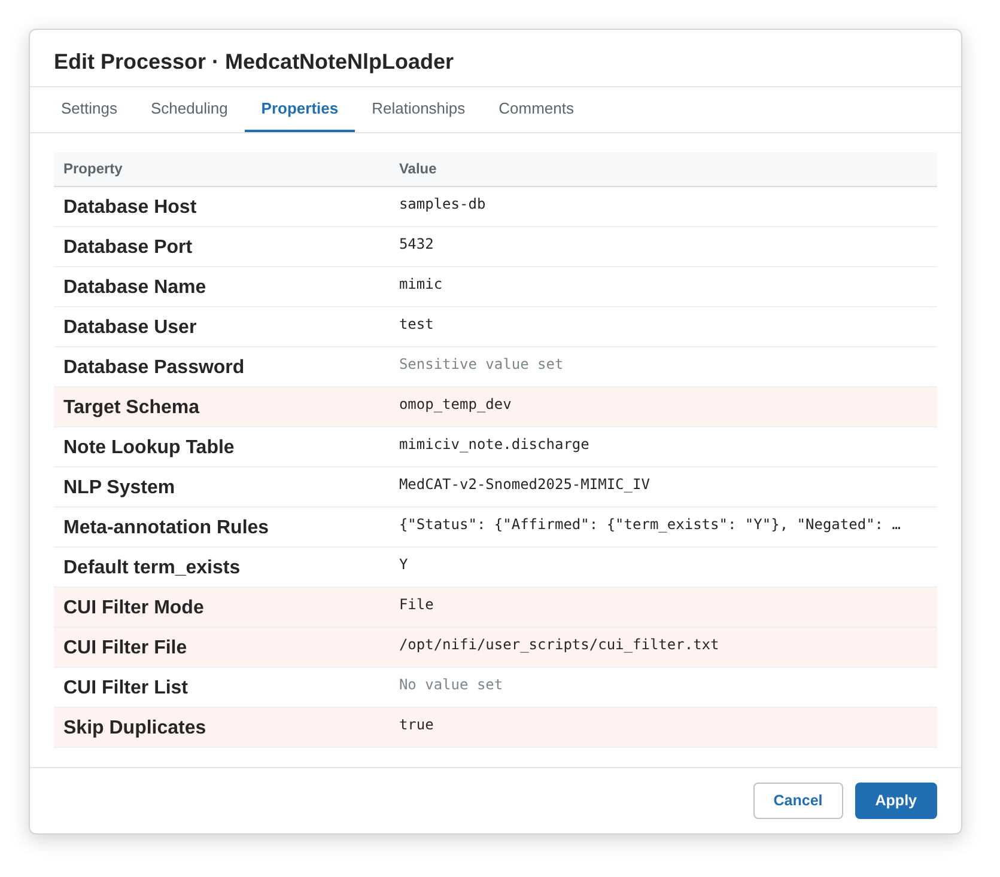

_MedcatNoteNlpLoader properties in flow 5. Illustration, not a screenshot._

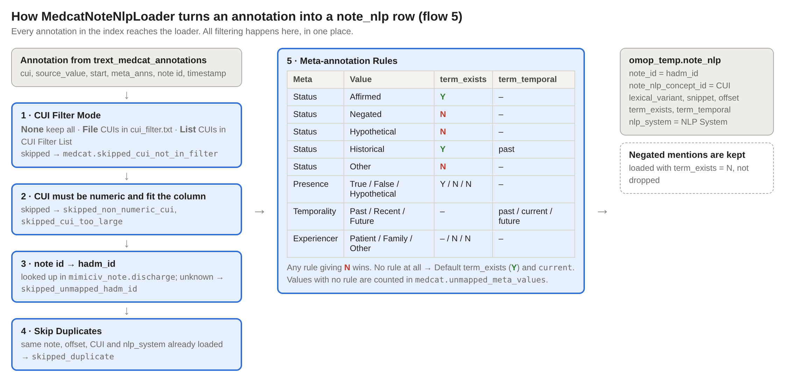

**Before starting:**

- [ ] **Enter the Database Password** on MedcatNoteNlpLoader.
- [ ] **Check the loader is version 1.3.0.** Version 1.2.0 looks annotations up by `id`, which annotations from the current flow 2 don't have, so it skips them all. If the processor shows 1.2.0, install `medcat_omop_note_nlp_loader.py` 1.3.0, restart NiFi, then right-click → **Change Version**.
- [ ] **Confirm `cui_filter.txt` is in the container.** If it's missing, the loader won't start; it reports a file-not-found error rather than loading everything.
- [ ] **Widen the delay while flow 2 works through its backlog.** Annotations are timestamped when MedCAT processes them, but during a backlog they can wait in flow 2's queues for more than 2 minutes before being indexed. Any annotation indexed after this flow has passed its timestamp is missed. During the first load, use for example `now-30m`, or start this flow only after flow 2 has finished.
- [ ] **After the first run, check `medcat.skipped_unmapped_hadm_id` is 0** on the loader's output FlowFiles (List Queue → a FlowFile → Attributes).
- [ ] **Check the model's Status values** against the Meta-annotation Rules. The `medcat.unmapped_meta_values` attribute on the loader's output lists any value that has no rule.

**To change the CUI list later:**

1. Update `cui_filter.txt` in `../nifi/user_scripts/` (the container's `/opt/nifi/user_scripts/`).
2. Stop and start the loader, so it rereads the file.
3. If you added CUIs, stop ConsumeElasticsearch, **View State → Clear State**, and start it again. This re-streams older annotations, and Skip Duplicates prevents duplicate rows.

## Appendix: about the images

All images are in `images/` and illustrative.
