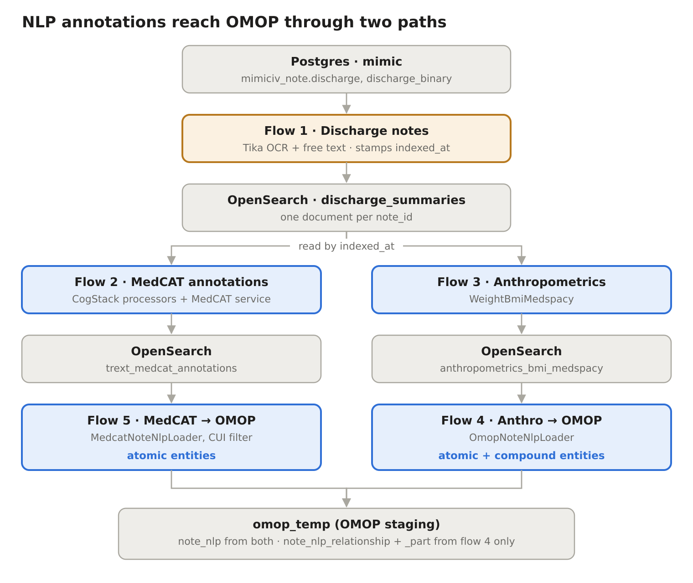
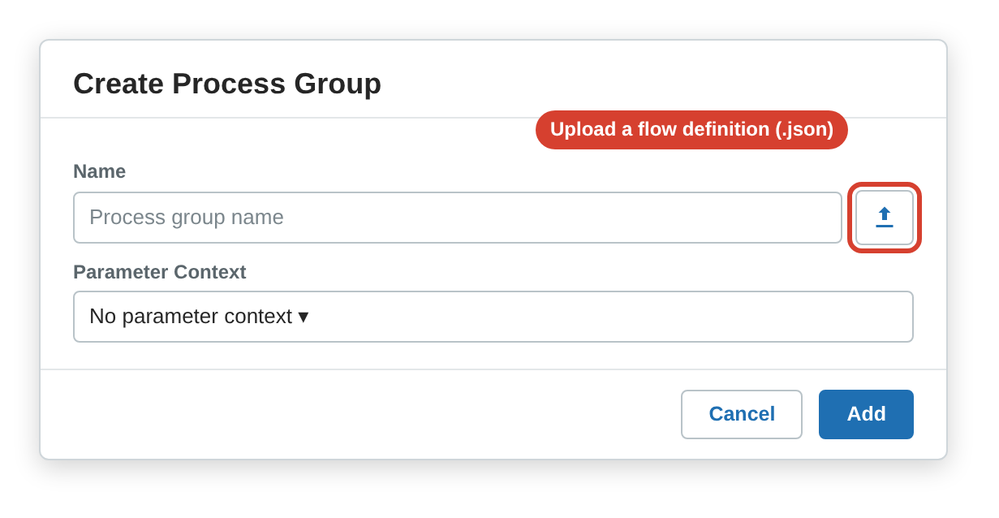
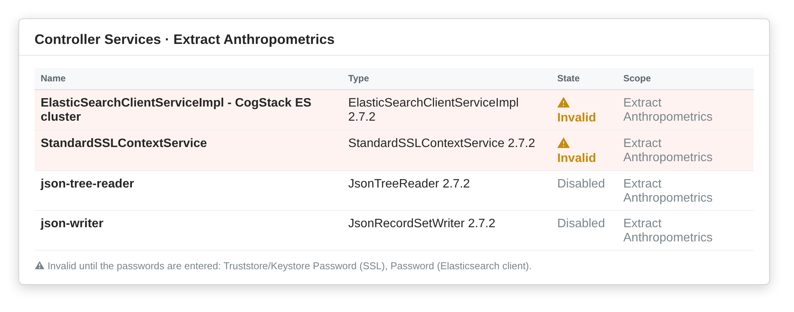

# Creating the NLP pipeline

TRExt runs as five NiFi flow definitions (JSON files exported from NiFi 2.7.2). Together they take MIMIC-IV discharge notes from Postgres, index them in one OpenSearch index (`discharge_summaries`), run two NLP pipelines over that index (MedCAT and medspaCy), and load the results into the OMOP staging schema `omop_temp`.



| # | Flow (process group name) | What it does |
| -- | ------------------ | ---------------------------------------------- |
| 1 | Ingest binary docs to OpenSearch | Loads every discharge note into `discharge_summaries`, one document per `note_id`. One subgroup sends the PDF/DOCX versions in `discharge_binary` through the Tika OCR service; the other copies the free-text notes. Both write the same fields, and the later write wins. |
| 2 | Ingest annotations to OpenSearch - Refined | Reads new and replaced notes from `discharge_summaries`, sends them to the MedCAT service and indexes one document per annotation in `trext_medcat_annotations`. Each annotation carries its note's `note_id`, `subject_id` and `hadm_id`. |
| 3 | Extract Anthropometrics | Reads new and replaced notes from `discharge_summaries`, runs the medspaCy weight/BMI pipeline over them and indexes the results in `anthropometrics_bmi_medspacy`. |
| 4 | Load anthropometrics to OMOP staging DB | Compound entity path. Reads `anthropometrics_bmi_medspacy` and writes weight, height, BMI and obesity rows to `omop_temp.note_nlp` and the relationship tables. |
| 5 | Load mental health mentions to OMOP staging DB | Atomic entity path. Reads `trext_medcat_annotations` and writes one `omop_temp.note_nlp` row per mental health mention, for the CUIs in `cui_filter.txt`. |

Flows 2 and 3 read flow 1's index, flow 4 reads flow 3's, and flow 5 reads flow 2's. Flow 1 stamps each document with `indexed_at` when it writes it; flows 2 and 3 track that field, so they pick up both new notes and notes that flow 1 has replaced (for example, an OCR version replacing the free-text one).

## Atomic and compound NLP entities

The two NLP paths load different kinds of entity into OMOP:

- **Atomic entities (MedCAT: flows 2 → 5).** Each mention is a single concept, such as a SNOMED CT finding, written as one `note_nlp` row. Its meta-annotations become `term_exists` (Y/N) and `term_temporal`. This path writes nothing to the relationship tables.
- **Compound entities (medspaCy: flows 3 → 4).** A measurement has several parts: the concept (body weight), its value (82) and its unit (kg). Each part is its own `note_nlp` row. A `note_nlp_relationship` row of type `COMPOUND_MEASUREMENT` groups them, with one `note_nlp_relationship_part` row per part giving its role (`component`, `has_measured_value` or `scale_type`). This path also writes atomic rows: BMI mentions (with `value_as_number`), "obesity" mentions, and the derived BMI.

So only flow 4 writes to the relationship tables. To read a compound entity back, join `note_nlp_relationship` to `note_nlp_relationship_part` on `relationship_id`, then to `note_nlp` on `note_nlp_id`.

## Generate the OpenSearch certificates

NiFi connects to OpenSearch over HTTPS. Its SSL Context Service uses `elasticsearch-1-keystore.jks` and `elasticsearch-1-truststore.key` from `security/certificates/elastic/opensearch/elasticsearch/elasticsearch-1/`, mounted read-only into NiFi at `/security/`. These are generated for each deployment and never committed. If that folder is empty, generate them before starting the stack. From `deploy/`, on checkouts whose Makefile has `init-security` targets:

```
make init-security-opensearch
```

On older checkouts, run the scripts from `security/scripts/`. Run `create_root_ca_cert.sh` only if `security/certificates/root/` is empty, because a new root CA invalidates every certificate it signed.

```
./create_root_ca_cert.sh
./create_opensearch_node_cert.sh elasticsearch-1 elasticsearch-2 elasticsearch-3
./create_opensearch_client_admin_certs.sh
```

The keystore, key and truststore password is `ES_CERTIFICATE_PASSWORD` in `security/env/certificates_elasticsearch.env`. The OpenSearch admin login is `ELASTIC_USER` / `ELASTIC_PASSWORD` in `security/env/users_elasticsearch.env`. Change both defaults for any real deployment.

## Start the stack

From the CogStack-NiFi repository's `deploy` folder (the one with the Makefile), run:

```
make start-data-infra
```

This starts NiFi (with its nginx proxy and registry), OpenSearch (`elasticsearch-1`, `elasticsearch-2`) with OpenSearch Dashboards, the samples Postgres database (`cogstack-samples-db`) with pgAdmin, the MedCAT service, the OCR services, JupyterLab and Label Studio. `make stop-data-infra` stops them all. Each part also has its own target, such as `make start-nifi` or `make start-elastic`.

## Install the custom processor files

The flow definitions don't contain the custom Python processors, Groovy scripts or CUI filter. `services.yml` mounts the NiFi container's file folders from the repository, so copy the files into these host folders (paths from `deploy/`) before importing. Files there survive `make start-nifi`, which recreates the container.

| Files | Host folder | Path in the container |
| -- | -- | -- |
| `weight_and_bmi_medspacy_extraction.py`, `omop_note_nlp_loader.py`, `medcat_omop_note_nlp_loader.py` | `../nifi/user_python_extensions/` | `/opt/nifi/nifi-current/python_extensions/` |
| The three flow 1 Groovy scripts (combined-output versions), `cui_filter.txt` | `../nifi/user_scripts/` | `/opt/nifi/user_scripts/` |
| `document-mimic.avsc` | `../nifi/user_schemas/` | `/opt/nifi/user_schemas/` |
| `postgresql-42.7.7.jar` | `../nifi/drivers/` | `/opt/nifi/drivers/` |

Then make them readable by the NiFi user and restart NiFi:

```
chmod -R a+rX ../nifi/user_python_extensions ../nifi/user_scripts ../nifi/user_schemas ../nifi/drivers
docker restart cogstack-nifi
```

NiFi finds the Python processors by the class name inside each file (`WeightBmiMedspacy` 1.0.3, `OmopNoteNlpLoader` 1.0.3, `MedcatNoteNlpLoader` 1.3.0), not by the file name. The first time each one is used, NiFi installs its Python dependencies into `/opt/nifi/user_scripts/extensions/<class name>/<version>/` (`../nifi/user_scripts/extensions/` on the host). For `WeightBmiMedspacy` (medspaCy, spaCy and NumPy below 2) this takes several minutes.

The OMOP staging DB initialisation scripts must already have created `note_nlp`, `note_nlp_relationship` and `note_nlp_relationship_part` in `omop_temp`, with the concept ID columns as `bigint`, and the index `note_nlp_note_system_idx` on `(note_id, nlp_system)`.

## Import the flows

Log in to NiFi (default port 8443, default login admin/cogstackNiFi). For each flow file:

1. Drag the **Process Group** icon from the top toolbar onto the canvas.
2. Click the upload icon next to the Name field (Figure 2), choose the `.json` file, then click **Add**.



## Finish the setup of each flow

1. **Re-enter the passwords.** Flow definitions never contain passwords. Open the group, right-click empty canvas → **Controller Services**, and fill in the SSL Context Service passwords (keystore, key and truststore), the Elasticsearch client password (user `admin`) and, in flow 1, the DBCP pool password (user `test`). Flows 4 and 5 also need the Database Password on their loader processor.
2. **Check the connection details match your deployment:** the Postgres host in flow 1's DBCP pools and the loader processors, the OpenSearch hosts in the Elasticsearch client, the certificate paths in the SSL Context Service, and the OCR and MedCAT URLs in the InvokeHTTP processors (see Default Port Bindings).
3. **Enable the services.** Enable each SSL Context Service first, then the Elasticsearch client, any DBCP pool and the record readers and writers. Every processor should then show a red stop square, not a yellow warning.
4. **Check the Python processors.** A processor shown as missing means its `.py` file isn't installed, or declares a different version. Right-click it → **Change Version** to pick the installed one.



## Start the flows

1. Start flow 1, and wait until `discharge_summaries` has data.
2. Test flows 2 and 3 on a few patients first. On each flow's ConsumeElasticsearch, set Additional Filters to `[{"range": {"indexed_at": {"lt": "now-5m"}}}, {"range": {"subject_id": {"lt": 10010000}}}]` (about 0.1% of patients) and start the flow. Check the results in `trext_medcat_annotations` and `anthropometrics_bmi_medspacy`, then set Additional Filters back to the `indexed_at` filter alone, clear the processor's state and start it again.
3. Start flow 4 once flow 3 has finished its first full pass, and flow 5 once flow 2 has indexed annotations. After flow 5's first run, check that the loader's `medcat.skipped_unmapped_hadm_id` attribute is 0.

Each flow reads incrementally: its first processor keeps a checkpoint and reads only new data on each run. To re-read everything, stop that processor, right-click → **View State → Clear State**, and start it again.

Flow 5 sets `note_nlp.note_id` to the annotation's `hadm_id`, and loads only the CUIs listed in `cui_filter.txt` (MedcatNoteNlpLoader's CUI Filter Mode = File). Negated mentions are kept, with `term_exists = N`. To change the CUI list, edit the file, stop and start the loader, and clear ConsumeElasticsearch's state to re-read older annotations.

Failed FlowFiles wait in funnels with no outgoing connection. Check them now and then, and empty the queue once you've dealt with them.

The full step-by-step guide, with every processor's settings and checks, is in *CogStack NiFi 2.0 workflows: setup guide* ([README](../README.md)).
